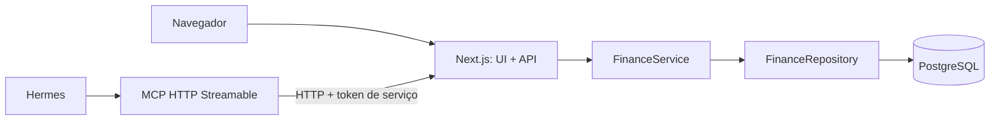

# Arquitetura — marvin-project

> **Estado atual:** implementação presente; decisões de consistência e BRL em [ADR 0010](docs/adr/0010-platform-consistency-and-brl.md). Evidências datadas e limitações operacionais estão em [verification.md](docs/verification.md).

## 1. Contexto e topologia atual

O projeto é uma aplicação financeira pessoal self-hosted, inicialmente para uma pessoa. A UI e API HTTP estão em `apps/web`; `apps/mcp` é um processo separado que chama a API; os pacotes compartilhados separam contratos, domínio e PostgreSQL.



Dockerfiles e `infra/compose.yml` estão no checkout. Compose define `web`, `mcp`, `db` e `migrate` sob profile `ops`; o serviço de migration é executado explicitamente. Deploy real, proxy, backup e restauração não foram verificados no homelab. Ver [ADR 0003](docs/adr/0003-homelab-deployment.md) e [docs/deployment.md](docs/deployment.md).

## 2. Workspaces e limites

| Workspace | Papel no código atual | Fronteira pretendida |
|---|---|---|
| `apps/web` | Next.js UI, handlers HTTP, auth e composição de `FinanceService` + repositório | Único acesso permanente da aplicação ao DB; sem regras financeiras em componentes |
| `apps/mcp` | SDK MCP Streamable HTTP, bearer auth, schemas de entrada e cliente HTTP da API | Sem SQL, `packages/db` ou cálculos financeiros próprios |
| `packages/contracts` | Schemas Zod, DTOs e envelopes públicos | Sem persistência ou dependência de apps |
| `packages/domain` | `FinanceService`, regras monetárias e interface `FinanceRepository` | Sem Drizzle, Next.js ou dependências de apps |
| `packages/db` | Schema Drizzle, cliente PostgreSQL e implementação do repositório | Implementa a porta de persistência do domínio |

O web compõe diretamente domínio e DB no servidor. MCP encaminha operações por HTTP e envia `Idempotency-Key` nas escritas. O Compose não fornece `DATABASE_URL` ao MCP; a rede do banco é interna e somente web/migration participam dela.

Os limites descrevem a estrutura pretendida e a organização observada. Compilação, testes dos workspaces e fluxos HTTP/MCP de dev e produção passaram no gate local. Não há suíte de teste automatizada específica de fronteiras de importação.

## 3. API, contratos e autenticação

`packages/contracts` centraliza schemas runtime e contratos de entradas/saídas, exclusivamente em BRL. A API web oferece leituras de contas, categorias, transações, resumo, distribuição por categoria, faturas, configurações de cartão e previsões; escritas de instituição, contas, categorias, receitas, despesas, transferências, compras no crédito, cashback, estornos, pagamentos/fechamento de faturas, previsões, correções e reversões. Toda escrita POST exige chave de idempotência e valida os corpos com Zod.

Limites atuais da API:

- API expõe criação e alteração idempotente das configurações de cartão; mudanças não reescrevem faturas históricas encerradas.
- Fechamento manual de fatura usa rota idempotente. O web também executa catch-up periódico de fechamento automático no runtime Node.
- Preview transacional está exposto em `POST /api/v1/transactions/preview`, sem gravar movimentações; previsões avulsas têm rotas de criar/listar/realizar/cancelar.
- Correções não financeiras são revisões append-only; alterações financeiras usam reversão compensatória e substituição atômica. A rota de contas também retorna limite disponível do cartão quando configurado.

Web usa cookie de sessão assinado, token CSRF e proteção básica de tentativas no login. MCP usa bearer token próprio para Hermes e token de serviço distinto para a API. `.env.example` e Compose incluem `APP_ORIGIN` e `WEB_PASSWORD_HASH`, nomes lidos pela rota de login.

## 4. Domínio financeiro e persistência

A plataforma atual aceita somente BRL. Preparação financeira por operação é compartilhada por preview e commit; o commit revalida em transação. Datas persistidas de faturas prevalecem sobre templates. Situação de pagamento/atraso e crédito são derivados na leitura. Relatórios usam `reporting.load()` com seis buscas em lote dentro de um snapshot, compartilhando projeção de operações efetivas; a série mensal evita uma consulta HTTP por mês. Ver ADR 0010.


`FinanceService` trabalha com `bigint` e `packages/contracts` transmite valores monetários como strings inteiras. O serviço implementa operações idempotentes, saldos derivados de entradas, validação de categorias/moedas, alocação de compra parcelada, cashback, estorno proporcional e pagamentos parciais. O repositório PostgreSQL usa transações serializáveis com retry limitado para falhas de serialização/deadlock; claims idempotentes guardam hash do payload e resultado.

O schema/migration atual inclui instituições, contas, configurações de cartão, categorias, transações, entradas, alocações, previsões, revisões, planos de parcelas, faturas, itens, pagamentos, solicitações de agente e claims de idempotência. Constraints e triggers cobrem limites entre linhas; tabelas de histórico financeiro são protegidas conforme as migrations. As migrations foram aplicadas nos testes PostgreSQL e em clusters descartáveis de recovery; não houve acesso a banco de usuário. Ver [docs/migrations.md](docs/migrations.md) e [docs/verification.md](docs/verification.md).

Decisões operacionais observáveis no código: dias de calendário curtos limitam ao último dia do mês; o restante do estorno entre categorias é distribuído centavo a centavo em ordem estável das alocações efetivas; alterações históricas usam novas operações rastreáveis. `closeAutomaticStatements(throughDate)` é invocado pelo processo periódico do web. Detalhes em [ADR 0005](docs/adr/0005-mvp-operational-behavior.md) e [ADR 0007](docs/adr/0007-automatic-statement-closing.md).

## 5. MCP

O servidor responde em `/mcp` via Streamable HTTP e expõe `/healthz`. Ferramentas incluem consultas, preview, escritas financeiras, configurações de cartão, previsões avulsas, correções e reversões; a lista atual e contratos estão em [docs/mcp.md](docs/mcp.md).

As escritas financeiras são encaminhadas sem acesso direto ao banco. `close_statement` usa a rota idempotente da API; `preview_transaction` não persiste dados. A suíte MCP passou com quatro testes, incluindo chamada Streamable HTTP e replay de cancelamento de previsão. E2E dev e produção passaram pelos fluxos HTTP/MCP; os cenários e limites estão em [docs/integration-validation.md](docs/integration-validation.md).

## 6. UI

`apps/web` implementa a identidade visual escura nas áreas de resumo, contas, cartões, lançamentos, faturas, relatórios e configurações, no login e nos diálogos. A decisão aceita está no [ADR 0008](docs/adr/0008-web-visual-system.md), apoiada nos [requisitos](specs/refatoracao-visual/requirements.md) e no [design](specs/refatoracao-visual/design.md) da refatoração visual.

O tema é exclusivamente escuro: `.dark` na raiz e `color-scheme: dark`, sem paleta clara, seletor ou adaptação à aparência do dispositivo. `globals.css` centraliza tokens CSS semânticos de superfície/conteúdo, ações, estados, borda, foco e navegação, mapeados por `@theme inline` no Tailwind 4. Esses papéis permitem um tema claro futuro, ainda não implementado. Geist e JetBrains Mono são servidas localmente pelos pacotes `@fontsource-variable`, sob SIL OFL 1.1, sem buscar fontes em serviço externo.

`components.json` configura shadcn/ui `base-nova`; `components/ui` contém os componentes reais de composição e primitivas Base UI onde aplicável, incluindo botão e diálogo. `app-shell.tsx` concentra navegação lateral desktop, navegação móvel e cabeçalho; `action-dialog.tsx` concentra a apresentação dos formulários, prévias e revisões. `workspace.tsx` mantém coordenação de sessão, consultas e operações. O fluxo de envio preserva corpos HTTP, CSRF, prévia, revisão e reutilização de chave idempotente. Na página de nova transação, receita e despesa compartilham os campos principais sem perder valor, descrição, conta e data ao alternar o tipo; detalhes opcionais ficam recolhidos. Despesas usam categoria única com o valor integral por padrão e rateio explícito opcional. A revisão ocupa uma etapa própria, preservando o formulário para edição e nova validação. Consultas de relatório e configuração de cartão descartam respostas obsoletas para evitar associação de dados à seleção errada. O dashboard e os relatórios consultam resumos mensais e distribuição por categoria no domínio, separando moedas; o formulário de nova transação também pode ser apresentado como página, mantendo o mesmo fluxo de revisão.

A rota `/settings` reúne criação de instituições, contas, cartões e categorias e configuração de fechamento dos cartões, reutilizando os formulários existentes. A navegação desktop mostra “Configurações”; no mobile, a área fica em “Mais”. Esses cadastros não aparecem no menu “Novo registro”, nos atalhos do resumo nem nas telas de consulta de contas e cartões. A criação contextual de categoria durante um lançamento continua disponível. Esta organização segue os limites de UI desta seção e reutiliza as entidades do modelo de dados §4, sem mudanças financeiras ou de persistência.

O campo de categoria em novas receitas, despesas, compras no crédito, cashback e previsões permite criar e selecionar categorias ou subcategorias sem sair do formulário. `category-picker.tsx` reutiliza o diálogo existente; `workspace.tsx` chama `POST /api/v1/categories` com CSRF e idempotência, valida a resposta e atualiza as referências locais. A categoria é salva separadamente da transação, inclusive se o lançamento for cancelado. Subcategorias exibem o caminho da hierarquia e a categoria superior é filtrada pelo tipo da operação.

A refatoração não altera domínio, contratos, persistência, API, MCP ou autenticação. Valores continuam usando formatação inteira e moedas separadas. Recursos sem suporte real no Figma são omitidos, inclusive gráficos sem séries completas, metas, sincronização e análises por IA; previsões e demais operações existentes permanecem disponíveis. A organização é mobile first, com estados de carregamento, vazio, erro e sucesso e suporte de foco e movimento reduzido no código.

Resultados datados e limites da validação ficam em [docs/verification.md](docs/verification.md); capturas e verificações de interface estão em [docs/ui-validation.md](docs/ui-validation.md).

## 7. Desenvolvimento e validação

Gerenciador: pnpm Workspaces, lockfile na raiz, sem Turborepo. Comandos disponíveis nos manifests:

```bash
pnpm --filter @finance/web dev
pnpm --filter @finance/mcp dev
pnpm --filter @finance/db db:migrate
pnpm typecheck
pnpm lint
pnpm test
pnpm build
```

`pnpm test` executa os workspaces configurados. `bash scripts/test-postgres.sh` provisiona somente PostgreSQL descartável e exige zero skips. Resultados atuais de typecheck, lint, testes, builds Docker/local, E2E e limitações estão em [docs/verification.md](docs/verification.md).

Para desenvolvimento local, `pnpm db:up` aplica `infra/compose.dev.yml`: preserva o volume, publica PostgreSQL somente em localhost e adiciona uma rede bridge de desenvolvimento apenas ao DB. Os scripts de carga/limpeza preferem `DEVELOPMENT_DATABASE_URL`; a conexão interna `DATABASE_URL` dos containers é preservada. O Compose de deploy continua sem publicar o banco. Veja [ADR 0009](docs/adr/0009-local-development-database.md).

O pacote DB também fornece `pnpm db:seed` e `pnpm db:clean`, exclusivos para PostgreSQL local de desenvolvimento com confirmação `SEED_DEVELOPMENT=true` e bloqueio em produção. O seed primeiro trunca as tabelas da aplicação, preservando schema e migrations, e cria três meses relativos à data de São Paulo usando `FinanceService`: compras, receitas, despesas e parcelas, com faturas anteriores pagas e atuais abertas em modo manual. A limpeza também pode ser executada separadamente. A carga é atômica por operação, não globalmente; detalhes e efeitos destrutivos estão no README. Essa ferramenta de desenvolvimento não altera as regras de histórico da API.

## 8. Segurança e dados

- Não expor PostgreSQL à rede externa; MCP deve conversar apenas com API HTTP autenticada.
- Dinheiro sempre em unidades mínimas inteiras; moedas permanecem separadas sem FX.
- Transferência interna e pagamento de fatura não criam receita/despesa nova.
- Compra parcelada reconhece a obrigação integral uma vez; itens das faturas não movimentam saldo.
- Escritas compostas devem ser atômicas e idempotentes. Não enviar segredos, payloads financeiros ou mensagens privadas a logs.
- Correções financeiras preservam a operação original e acrescentam lançamentos vinculados; não apagar ou editar histórico encerrado.

A modelagem detalhada e os casos de aceite permanecem em [docs/data-model.md](docs/data-model.md). Estado por requisito está em [docs/verification.md](docs/verification.md).

## 9. Arquivos de documentação

| Arquivo | Conteúdo |
|---|---|
| `README.md` | Estado atual e comandos de desenvolvimento |
| `AGENTS.md` | Regras de contribuição e invariantes |
| `docs/data-model.md` | Handoff financeiro e requisitos do MVP |
| `docs/verification.md` | Evidências, lacunas e validação executada |
| `docs/implementation-decisions.md` | Regras já implementadas no domínio |
| `docs/migrations.md` | Banco, migration, constraints e testes |
| `docs/api.md` | Contratos e endpoints HTTP documentados |
| `docs/mcp.md` | Transporte, auth e ferramentas MCP |
| `docs/deployment.md` | Compose, variáveis e operação planejada |
| `docs/adr/` | Decisões arquiteturais e de comportamento |

## 10. Investimentos — futuro, fora do MVP

Investimentos continuam fora do escopo explicitamente autorizado. A proposta está em [docs/data-model.md §17](docs/data-model.md#17-investimentos--proposta-futura) e [ADR 0001](docs/adr/0001-investment-accounting.md). Não há código, schema ou migrations de investimentos nesta entrega.
