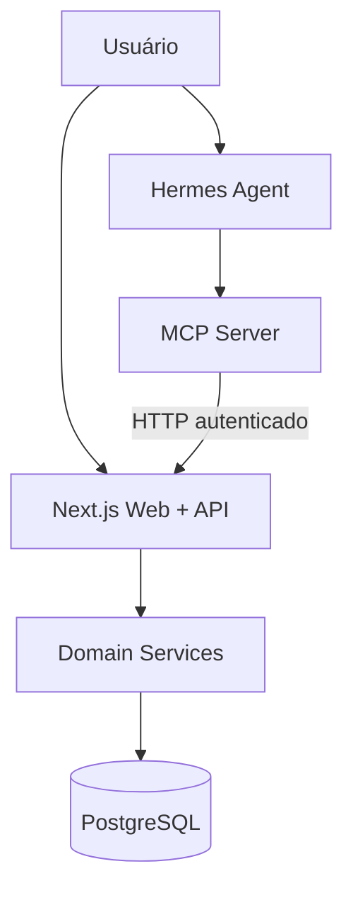

# Arquitetura — marvin-project

> **Status:** arquitetura-alvo para o bootstrap; componentes descritos aqui ainda podem não existir.  
> **Princípio central:** monorepo ≠ processo único. Há aplicações executáveis separadas, pacotes compartilhados e **uma única autoridade de escrita financeira**.

A stack foi definida no [ADR 0002](docs/adr/0002-application-stack.md): Next.js App Router/React/TypeScript, Tailwind CSS e shadcn/ui, API em Node.js com Route Handlers, PostgreSQL e Drizzle. Trata-se de uma decisão para implementação, sem alterar o status de planejamento.

## 1. Contexto

O marvin-project é uma aplicação financeira pessoal self-hosted. O usuário interage pelo navegador (desktop/mobile) ou envia mensagens a um Hermes Agent na rede do homelab. O Hermes interpreta a intenção e aciona ferramentas MCP, mas não executa cálculos contábeis nem acessa o banco diretamente.

### Requisitos arquiteturais

- Implantação privada em Docker/homelab; acesso por LAN/VPN/Tailscale.
- Uma pessoa usuária inicialmente; autenticação simples na web e credencial separada para MCP.
- PostgreSQL como fonte de verdade.
- API, interface e agente compartilham regras de negócio, sem duplicação.
- Histórico e valores financeiros íntegros; transações atômicas, idempotência e recuperação via backup.
- Desenvolvimento organizado em monorepo TypeScript/`pnpm Workspaces`.

## 2. Visão de execução (container-level)



**Deploy definido, ainda a implementar:** Docker Compose em um único host do homelab, com um container por serviço permanente: `web` (frontend + API), `mcp` e `db` (PostgreSQL). Ver [ADR 0003](docs/adr/0003-homelab-deployment.md) e [plano de deploy](docs/deployment.md).

**Implantação prevista:**

| Componente | Unidade de deploy | Rede |
|---|---|---|
| `apps/web` | Container web/API Next.js | Acessível via reverse proxy privado |
| `apps/mcp` | Container servidor MCP Node.js | Endpoint acessível pelo Hermes, com bearer token |
| PostgreSQL | Container DB e volume persistente | Apenas rede interna de serviços |
| Hermes Agent | Serviço existente no LXC | Cliente do endpoint MCP, fora do monorepo |

Como o Hermes e o Docker podem executar em hosts/containers distintos, o nome de serviço Docker não será necessariamente resolvido no LXC. Configurar endpoint por DNS/IP alcançável, firewall e autenticação. O reverse proxy e VPN já existentes no homelab podem ser reutilizados.

As redes de aplicação (`web`/`mcp`) e banco (`web`/`db`) serão separadas; o DB não publicará porta no host. MCP chamará o web pelo DNS interno do Compose, sem acesso à rede ou credenciais DB. Somente o web terá acesso permanente ao banco pela aplicação; migrations usarão execução temporária controlada. Reverse proxy privado atenderá web e MCP, reutilizando infraestrutura existente se disponível.

Health checks, política de reinício e reconexão serão configurados; migrations serão uma etapa explícita por deploy. PostgreSQL terá volume próprio e backups fora desse volume, com restauração testada. Imagens terão versões identificáveis e secrets serão fornecidos fora das imagens/Git. Um único host permanece ponto único de falha; proxy, host e política de backup finais ainda estão pendentes.

## 3. Topologia do código

```text
apps/web
  ├── Next.js App Router / componentes UI
  └── API HTTP / composição dos casos de uso
        ├── packages/contracts
        ├── packages/domain
        └── packages/db ── PostgreSQL

apps/mcp
  ├── SDK MCP / validação de chamadas / auth
  ├── packages/contracts
  └── HTTP client ── apps/web API
```

### Regras de dependência

| Módulo | Pode importar | Não deve importar |
|---|---|---|
| `apps/web` (somente servidor) | `domain`, `db`, `contracts` | Código interno de `apps/mcp` |
| `apps/web` (client components) | Componentes UI, tipos seguros de `contracts` | `db`, código server-only, secrets |
| `apps/mcp` | `contracts`, SDK MCP, cliente HTTP | `db`, repositórios, regras financeiras duplicadas |
| `packages/domain` | `contracts`, interfaces próprias | `apps/*`, Drizzle, Next.js |
| `packages/db` | Drizzle, implementações de portas definidas no domínio | `apps/*`, SDK MCP |
| `packages/contracts` | Dependências mínimas de schemas/tipos | `domain`, `db`, `apps/*` |

**Sem dependência circular `domain` ↔ `db`:** `domain` declara interfaces/portas de persistência; `db` as implementa; `apps/web` faz a composição/injeção.

Somente handlers e código de servidor podem instanciar repositórios. O frontend nunca recebe credenciais ou clientes do PostgreSQL.

## 4. Responsabilidades dos workspaces

### `apps/web`

- Next.js App Router/React/TypeScript, UI responsiva em pt-BR com Tailwind CSS e shadcn/ui. Adicionar somente componentes necessários em `apps/web`, preservando acessibilidade; seu código fará parte do projeto.
- Endpoints HTTP internos para contas, categorias, transações, faturas e relatórios.
- Validação de sessões, permissões, rate limits e idempotency keys.
- Composição dos serviços de domínio com implementações dos repositórios.
- Nunca incluir regras financeiras dispersas em componentes React ou handlers diferentes.

### `apps/mcp`

- Servidor MCP TypeScript, com transporte HTTP compatível com o Hermes.
- Ferramentas tipadas, ex.: `get_accounts`, `get_categories`, `preview_transaction`, `create_income`, `create_credit_purchase`, `create_transfer`, `get_card_statements`.
- Autenticação específica (bearer token), validação de entrada, logs sem dados sensíveis.
- Transformar chamadas MCP em requisições HTTP à API; **não escrever no banco**.

### `packages/contracts`

- Tipos/schemas de DTOs, enums públicos, códigos de erro e respostas compartilhadas.
- Não contém acesso a dados, regras de saldo nem dependências de frameworks.
- Evitar expor internals de banco e segredos em contratos reutilizados no browser.

### `packages/domain`

- Casos de uso (`CreateIncome`, `CreateExpense`, `CreateTransfer`, `CreateCreditPurchase`, `PayStatement`, etc.).
- Cálculo de parcelas, orçamento, fechamento, saldos e validações.
- Portas/interfaces para repositórios e clock/configuração de fuso.
- Operações financeiras multi-row agrupadas numa transação de persistência.

### `packages/db`

- Definições Drizzle, migrations versionadas, índices, constraints, repositórios e transações SQL.
- PostgreSQL como fonte de verdade; evitar `current_balance` mutável e duplicado.
- Sem regras de negócio específicas de MCP, UI ou roteamento.

## 5. Fluxos fundamentais

### 5.1 Lançamento manual

1. Usuário envia formulário pelo `apps/web`.
2. API autentica e valida o DTO de `contracts`.
3. `domain` aplica regras financeiras e idempotência.
4. `db` persiste todas as linhas em transação atômica.
5. API retorna IDs, valores efetivos e resumo do lançamento.

### 5.2 Hermes/MCP

1. Usuário conversa com Hermes (ex.: Discord).
2. Hermes extrai uma intenção, consulta ferramentas de contas/categorias e chama `preview` se necessário.
3. `apps/mcp` autentica a ferramenta e chama a **mesma API HTTP** utilizada pela web.
4. API aplica domínio + persistência; ferramenta retorna resultado estruturado.
5. Hermes confirma ao usuário os dados realmente salvos. Requisições repetidas com a mesma chave não duplicam lançamentos.

Web no navegador e MCP consumirão os mesmos endpoints HTTP e contratos de entrada, saída e erro de `packages/contracts`, com schemas de validação em runtime. Sessão web e credencial MCP serão distintas. Código de servidor do Next.js poderá chamar os mesmos casos de uso diretamente, sem HTTP para si próprio, preservando autenticação, validação e idempotência aplicáveis; não haverá regras financeiras paralelas.

### 5.3 Compra parcelada

1. Compra no crédito cria transação econômica e **uma entrada negativa pelo total** no cartão.
2. Plano de parcelas divide o valor inteiro em N linhas de faturas, com arredondamento exato.
3. Itens de fatura e alocações de orçamento indicam o mês de competência; não criam novas entradas patrimoniais.
4. Pagamento cria uma transferência bancária para o cartão e registra atribuição à fatura.
5. A interface mostra dívida total, fatura atual, próximas faturas e saldos sem dupla contagem.

### 5.4 Entradas de dinheiro

- Salário, rendimentos e cashback depositado na corrente: receita com `account_entry` positiva.
- Pix recebido **não é automaticamente receita**: pode ser transferência, reembolso ou presente.
- Estorno de despesa credita a conta e reduz a categoria original.
- Cashback/estorno aplicado no cartão reduz dívida e pode gerar item negativo na fatura.

## 6. Invariantes financeiros

O documento de modelagem (`docs/data-model.md`, handoff disponível no repositório) é a **fonte de verdade detalhada**. Resumo das regras que não podem ser violadas:

1. Valor monetário em inteiro de unidades mínimas; nunca `float`.
2. Saldo da conta = saldo de abertura + soma de `account_entries` relevantes.
3. Transferência entre contas próprias não compõe receita/despesa.
4. Pagamento de fatura não é despesa nova.
5. Compra parcelada aumenta dívida total uma vez; soma de parcelas = valor da compra.
6. Data da compra, competência orçamentária e pagamento bancário são distintos.
7. Orçamentos por moeda não são somados sem taxa de câmbio explícita.
8. Categorias, contas e faturas históricas devem ser preservadas, ajustadas com rastreabilidade.

## 7. Segurança e configuração

- Acesso web restrito por rede privada e sessão/autenticação simples; VPN não substitui autenticação em operações de escrita.
- MCP com token independente, restrição de rede e possibilidade de rotação.
- Sem PostgreSQL público e sem credenciais DB no processo MCP.
- Variáveis de ambiente documentadas em `.env.example`; `.env` real fora do controle de versão.
- Logs sem credenciais e, por padrão, sem texto financeiro bruto do usuário.
- As ferramentas de IA executam somente operações restritas e tipadas; jamais SQL arbitrário.
- Backups PostgreSQL e restauração testada antes do uso com dados reais.

## 8. Monorepo: ferramentas e entrega

- **pnpm Workspaces:** gerencia `apps/*` e `packages/*` e um lockfile único.
- **Sem Turborepo inicialmente:** scripts pnpm por workspace são suficientes na primeira fase; avaliar quando houver gargalo real.
- Next.js pode consumir pacotes internos TypeScript, com `transpilePackages` quando a configuração exigir.
- Construir imagens separadas para `web` e `mcp`; ambos compartilham código em build-time, **não** banco/código em runtime sem limites claros.
- `infra/compose.yml` deverá definir `web`, `mcp` e `db` (PostgreSQL), redes privadas, volume DB e health checks; arquivo ainda não criado. O ambiente final seguirá `docs/deployment.md`.

## 9. Documentação e ADRs

| Arquivo | Responsabilidade |
|---|---|
| `README.md` | Visão do projeto e comandos de desenvolvimento |
| `ARCHITECTURE.md` | Topologia, workspaces e limites de dependência |
| `AGENTS.md` | Políticas de trabalho para agentes programadores |
| `docs/data-model.md` | Entidades, contas, faturas, parcelamentos e invariantes |
| `docs/api.md` | Endpoints HTTP e contratos versionados |
| `docs/mcp.md` | Ferramentas e autenticação MCP |
| `docs/deployment.md` | Docker, rede, backup/restauração, configuração |
| `docs/flows/*` | Sequências financeiras complexas |
| `docs/adr/*` | Contexto, decisão, alternativas e consequências |

ADRs iniciais sugeridos: escolha do monorepo/pnpm, PostgreSQL/Drizzle, MCP via API HTTP, reconhecimento de compra parcelada e estratégia de múltiplas moedas.

Ao modificar uma regra financeira, atualizar `docs/data-model.md` e cenários de validação. Ao modificar fronteiras de dependências ou infraestrutura, atualizar este documento e criar/substituir um ADR.

## 10. Decisões ainda abertas

Não presumir silenciosamente:

- Competência padrão do orçamento por mês de **vencimento**, fechamento ou compra (recomendação inicial: vencimento; configurável).
- Regras específicas do emissor na data de fechamento, ajustes do calendário e estornos de parcelas.
- Política de conversão de moedas para patrimônio consolidado.
- Autenticação web final (sessão local vs. proxy), preservando token MCP separado.
- Recorrências, sincronização bancária e parcelamento de fatura fora do MVP.

## 11. Critério de sucesso da arquitetura

Um agente deve ser capaz de:

1. Identificar onde colocar um novo endpoint, serviço de domínio, tabela ou ferramenta MCP.
2. Explicar por que MCP não fala com PostgreSQL diretamente.
3. Reproduzir os mesmos resultados financeiros via web e Hermes.
4. Executar `build`, `typecheck` e `lint` por workspace após o bootstrap.
5. Documentar novas decisões sem contradizer o handoff de modelagem.


## 12. Módulo de investimentos — arquitetura futura

**Somente planejamento; fora do bootstrap e do MVP atual.** A modelagem detalhada está em [docs/data-model.md §17](docs/data-model.md#17-investimentos--proposta-futura); a decisão de separar caixa, posições e avaliações está no [ADR 0001](docs/adr/0001-investment-accounting.md).

Uma conta `investment` pertence a uma instituição e representa somente caixa disponível. Aportes reutilizam transferências entre contas próprias. Compras convertem caixa em lotes de ativos; vendas, resgates e vencimentos liberam custo e reconhecem o resultado realizado separadamente. Avaliações alteram a visão patrimonial, sem criar movimentação monetária. O consolidado soma caixa, posições avaliadas e passivos assinados, com conversão explícita de moedas; nunca soma custo e avaliação da mesma posição.

Organização futura, **sem criar diretórios ou código nesta etapa**:

- `packages/contracts/src/investments/`: entradas, saídas, schemas de runtime e erros públicos.
- `packages/domain/src/investments/`: operações, custo, posições, valorização e portas de persistência; sem Drizzle, Next.js ou imports de apps.
- `packages/db/src/schema/investments/`: schema e persistência futura; repositórios implementam portas do domínio.

`apps/web` comporá os serviços e exporá a API autenticada. `apps/mcp` será adaptador HTTP tipado, sem SQL, dependência de DB ou cálculos próprios. O cliente web não terá acesso ao banco ou secrets. Transação financeira, caixa, consumo de lotes e classificação de resultado devem ser persistidos atomicamente, com idempotência e proteção contra resgates concorrentes. A extensão dos contratos existentes será revisada antes da implementação, sem reclassificar operações atuais.

Ferramentas apenas candidatas: `get_investment_accounts`, `get_investment_portfolio`, `create_investment_transfer`, `create_investment_purchase`, `register_investment_redemption`, `register_investment_income`, `get_upcoming_maturities`. Todas passarão pela API HTTP e validação do domínio; escritas exigirão autenticação própria e chave de idempotência. Hermes deverá confirmar ambiguidades e nunca inferir taxas, retornos ou vencimentos sem dados fornecidos/verificados.

Relatórios separarão saldo bancário, caixa da corretora, custo investido, valor atual das posições, resultados realizados, valorização não realizada, rendimentos recebidos, patrimônio, distribuição por classe e próximos vencimentos. Avaliações terão data e origem explícitas, inicialmente manuais; automação é evolução futura.

Permanecem abertas: método de custo, fonte e critérios de avaliação, reconhecimento de rendimentos, eventos corporativos e reconciliação de taxas/impostos. Não estão autorizados nesta fase integrações com corretoras, cotações automáticas, cálculo de CDI/IPCA ou tributação avançada.
