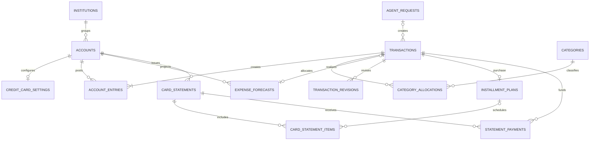
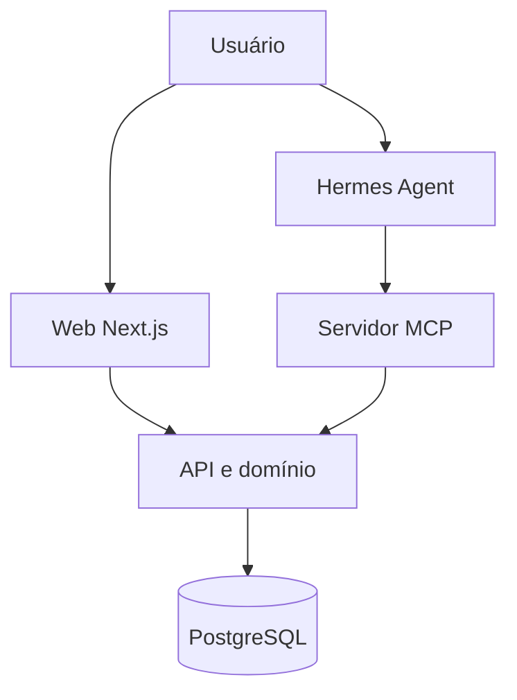

# marvin-project — Modelagem de Dados e Handoff Técnico

> **Status:** handoff arquitetural com partes implementadas; consulte [migrations](migrations.md) e [decisões de implementação](implementation-decisions.md) para o estado efetivo.
> **Versão:** 1.1 — 2026-10-31
> **Idioma do produto:** português (pt-BR); nomes técnicos em inglês  
> **Público:** agente de implementação, engenheiro full-stack e futuro mantenedor

## Regras vigentes após a auditoria de 31/10/2026

O [ADR 0010](adr/0010-platform-consistency-and-brl.md) restringe o produto atual a BRL, superando exemplos multimoeda deste handoff. A proposta de investimentos em §17 permanece futura e não autoriza implementação. Outras moedas exigem decisão futura, sem conversão automática de registros existentes.

Saldo antes da abertura é zero; o agregado omite a conta. Preview e gravação compartilham preparação e usam as datas da fatura persistida. Compras e estornos no dia do fechamento pertencem ao próximo ciclo. Resumos usam um snapshot e a mesma projeção econômica de categorias e série mensal.

Cancelamento usa compensação rastreável, sem DELETE, com original e compensação ocultos por padrão no extrato. Estorno real reduz a categoria original e credita a conta/cartão; parcelas e pagamentos são preservados. Fatura fechada sem valor a pagar é quitada; `creditBalanceMinor` informa excedente, sem alocação automática a outras faturas. Atraso deriva da data civil do cartão. `canReverse` vem do backend com histórico completo. `includePending` une o período solicitado às pendências existentes.

## 0. Objetivo e instruções ao agente

Construir uma aplicação **web, responsiva e self-hosted** de controle financeiro pessoal, utilizada prioritariamente por uma pessoa. O usuário poderá registrar operações manualmente ou por conversa com um **Hermes Agent**. O Hermes, hospedado no mesmo homelab, usará um servidor **MCP** para consultar contas/categorias e solicitar operações financeiras. Os dois caminhos precisam executar **as mesmas validações e regras de negócio**.

Este documento define **o modelo de domínio, os dados e os invariantes**; não autoriza inventar comportamentos financeiros ausentes. **Não implemente diretamente apenas a partir dos exemplos em JSON.** Primeiro crie um schema com migrations, valide os invariantes transacionais e proponha as decisões marcadas como abertas em §15.

**Princípios não negociáveis:**

1. Dinheiro em unidades mínimas inteiras (`BIGINT`), nunca `float`.
2. Toda alteração de saldo é derivada de movimentações (`account_entries`) e saldo inicial; não manter um campo `current_balance` editável como segunda fonte de verdade.
3. Uma transferência entre contas próprias **não é receita nem despesa**.
4. O pagamento de uma fatura **não é uma segunda despesa**: é transferência da conta corrente para o passivo do cartão.
5. Compra parcelada é **uma compra econômica e uma dívida integral**, distribuída em itens de faturas mensais. As parcelas **não debitam o passivo novamente**.
6. Separar **data da compra**, **competência da fatura** e **data da saída efetiva do dinheiro da conta corrente**.
7. A API é autoridade para cálculo de parcelas, datas, saldos e invariantes; o LLM nunca escreve SQL nem decide valores contábeis finais.
8. O aplicativo é privado, mas o MCP exige autenticação própria e idempotência.

## 1. Escopo e stack definida

### 1.1 Escopo do MVP

- Instituições financeiras e suas contas (corrente, poupança, dinheiro, cartão de crédito).
- Pix, débito, crédito, transferências, salários, rendimentos, cashback e estornos.
- Compras à vista e parceladas no crédito, faturas com fechamento/vencimento configuráveis, pagamentos parciais/totais.
- Categorias de despesa e receita, eventualmente hierárquicas, e transações divididas entre categorias.
- Controle básico: saldos, receitas, despesas, transferências, categorias, cartões, faturas e compromissos futuros.
- Orçamentos, metas e limites de gasto por categoria ficam fora do escopo inicial.
- Inclusão/edição manual pelo navegador desktop/mobile.
- Ferramentas MCP para consulta, validação, lançamento e correção via Hermes.
- Auditoria mínima, tratamento de duplicatas e backup.

### 1.2 Stack definida para implementação

Decisão registrada no [ADR 0002](adr/0002-application-stack.md), implementada nos workspaces atuais. Contratos HTTP compartilhados por web e MCP pertencem a `packages/contracts`; regras e validações financeiras pertencem a `packages/domain`.

| Camada | Escolha definida | Observação |
|---|---|---|
| UI | Next.js App Router, React, TypeScript, Tailwind CSS, shadcn/ui | Mobile-first; layout de desktop também completo |
| API | Next.js Route Handlers + camada `domain/services` | Concentrar validação e persistência |
| Banco | PostgreSQL | Uma instância no Docker/homelab |
| ORM/migrations | Drizzle ORM + Drizzle Kit | Preservar constraints SQL explícitas |
| MCP | SDK oficial MCP TypeScript, serviço Node isolado | Adaptador para API/domínio, sem lógica contábil duplicada |
| Deploy | Docker Compose | Serviços `web`, `mcp`, `postgres` |
| Acesso | LAN/VPN/Tailscale; sessão simples na web; bearer token no MCP | Não expor banco à rede externa |

O Hermes pode estar em um LXC e a aplicação em uma VM Docker; portanto o endpoint MCP deve ter um endereço/porta **roteável entre esses hosts**, não depender exclusivamente do DNS interno do Docker.

## 2. Semântica financeira

### 2.1 Instituição ≠ conta ≠ método de pagamento

Um banco (ex.: Nubank) pode reunir:

- **Conta corrente:** saldo em dinheiro, usada por Pix e cartão de débito.
- **Conta do cartão de crédito:** passivo/dívida, contabilizado com saldo negativo.
- **Método de pagamento:** `pix`, `debit`, `credit`, `bank_transfer`, `cash`, `other` — metadado da operação, não necessariamente uma conta independente.

Pix e débito que saem da mesma conta movimentam o **mesmo** `account_id`. Cartões de crédito devem possuir contas de passivo distintas; múltiplos cartões no mesmo banco podem ter contas distintas.

### 2.2 Convenções de sinal

- `account_entries.amount_minor > 0`: aumenta o saldo assinado da conta.
- `account_entries.amount_minor < 0`: diminui o saldo assinado da conta.
- Em conta corrente, gasto = negativo; salário = positivo.
- Em cartão de crédito, compra = negativo (dívida cresce); pagamento/estorno = positivo (dívida diminui).
- `category_allocations.amount_minor` acompanha o **sinal da movimentação econômica**: despesa negativa, receita positiva, estorno de despesa positivo.
- `card_statement_items.amount_minor` usa convenção de **cobrança da fatura**: positivo aumenta a cobrança; negativo é crédito/abatimento.

Não confundir os sinais das duas tabelas: um item de fatura positivo representa cobrança; a classificação da compra original é negativa e registrada uma única vez.

### 2.3 Três perspectivas de relatório

1. **Patrimônio/posição financeira:** reconhece **a dívida total da compra no cartão na data da compra**; calcula o saldo pela soma de `account_entries`.
2. **Compromissos futuros:** parcelas aparecem nas respectivas faturas, junto de projeções identificadas como previstas. Não há métrica de orçamento ou competência mensal por categoria no escopo inicial.
3. **Fluxo de caixa bancário:** quando a fatura é paga, há saída de dinheiro da conta corrente. O pagamento não gera nova despesa categorizada.

Os relatórios devem nomear claramente sua perspectiva. Não somar os lançamentos patrimoniais originais com todas as parcelas como se fossem despesas independentes. O relatório por categoria implementado usa a data da transação original, alocações efetivas e moeda da conta; reembolsos reduzem a despesa da categoria e operações revertidas são excluídas. A série mensal usa a mesma perspectiva do resumo de receitas e despesas.

## 3. Modelo entidade-relacionamento



**Nota:** diagramas ER representam relações conceituais, não todas as cardinalidades condicionais. Algumas invariantes dependem de `kind` e são validadas no domínio/na transação SQL.

## 4. Catálogo de entidades e campos

Tipos sugeridos para PostgreSQL: `UUID`, `TEXT`, `DATE`, `TIMESTAMPTZ`, `BIGINT`, `SMALLINT`, `BOOLEAN`, `JSONB`. Usar `CHECK`, `UNIQUE`, `FOREIGN KEY` e índices conforme §9.

### 4.1 `institutions`

| Campo | Tipo | Regras |
|---|---|---|
| `id` | UUID | PK |
| `name` | TEXT | obrigatório; ex.: Nubank, PKO, Revolut |
| `is_archived` | BOOLEAN | padrão `false` |
| `created_at`, `updated_at` | TIMESTAMPTZ | obrigatórios |

Não armazenar credenciais bancárias nesta tabela.

### 4.2 `accounts`

| Campo | Tipo | Regras |
|---|---|---|
| `id` | UUID | PK |
| `institution_id` | UUID NULL | FK `institutions` (pode ser nulo para dinheiro) |
| `name` | TEXT | obrigatório |
| `type` | TEXT | `checking`, `savings`, `cash`, `credit_card` |
| `currency` | CHAR(3) | exclusivamente `BRL` |
| `opening_balance_minor` | BIGINT | padrão `0`; assinado |
| `opening_date` | DATE | obrigatório |
| `is_archived` | BOOLEAN | padrão `false` |
| `created_at`, `updated_at` | TIMESTAMPTZ | obrigatórios |

Saldo assinado em uma data = `opening_balance_minor + SUM(account_entries.amount_minor para transactions.occurred_on entre opening_date e data de corte)`; operações anteriores ao saldo de abertura devem ser recusadas ou exigir redefinição da data-base. Cada entrada/saldo inicial gravado cabe em `BIGINT`, mas o agregado pode ultrapassar esse intervalo: manter `SUM(BIGINT)` como `numeric` no PostgreSQL e transportar derivados como `bigint`/string sem cast ou validação de `BIGINT`. **Não guardar saldo atual como fonte primária.**

### 4.3 `credit_card_settings`

| Campo | Tipo | Regras |
|---|---|---|
| `account_id` | UUID | PK/FK `accounts`; apenas `type=credit_card` |
| `credit_limit_minor` | BIGINT NULL | >= 0 |
| `closing_day` | SMALLINT | 1–31, respeitando fim do mês |
| `due_day` | SMALLINT | 1–31; não assumir mesmo mês de fechamento |
| `billing_timezone` | TEXT | fuso IANA válido configurado para o cartão; validar antes de persistir |
| `updated_at` | TIMESTAMPTZ | obrigatório |

Esses dias são **templates para gerar faturas futuras**. Datas reais de faturas persistidas não devem ser recalculadas automaticamente se a configuração mudar. Alterações de vencimento por feriados/regra do emissor podem ser feitas na fatura concreta.

### 4.4 `categories`

| Campo | Tipo | Regras |
|---|---|---|
| `id` | UUID | PK |
| `name` | TEXT | obrigatório |
| `type` | TEXT | `income` ou `expense` |
| `parent_id` | UUID NULL | FK para categoria pai; impedir ciclos |
| `is_archived` | BOOLEAN | padrão `false` |

Exemplos de receita: Salário, Cashback, Rendimentos, Presentes. Exemplos de despesa: Alimentação, Transporte, Moradia, Taxas, Saúde. Reembolso pode creditar uma **categoria de despesa** para reduzir o gasto líquido; não precisa existir uma categoria `income` artificial.

### 4.5 `transactions`

Uma linha representa um **evento econômico**, independentemente de quantas contas sejam movimentadas.

| Campo | Tipo | Regras |
|---|---|---|
| `id` | UUID | PK |
| `kind` | TEXT | `expense`, `income`, `transfer`, `refund`, `adjustment` |
| `occurred_on` | DATE | data econômica/compra; obrigatória |
| `posted_on` | DATE NULL | data efetiva do emissor/banco, se conhecida |
| `description` | TEXT | obrigatório |
| `counterparty_name` | TEXT NULL | estabelecimento, empregador ou remetente |
| `payment_method` | TEXT NULL | `pix`, `debit`, `credit`, `bank_transfer`, `cash`, `other` |
| `notes` | TEXT NULL | opcional |
| `source` | TEXT | `manual`, `hermes`, `import` |
| `review_status` | TEXT | `confirmed` ou `needs_review` |
| `origin_request_id` | UUID NULL | FK `agent_requests` |
| `related_transaction_id` | UUID NULL | para estorno/correção vinculada |
| `idempotency_key` | TEXT NULL | única por origem quando fornecida |
| `created_at`, `updated_at` | TIMESTAMPTZ | obrigatórios |

No MVP, só registrar em `transactions` operações aceitas; propostas incertas do agente ficam em `agent_requests` até aprovação. Uma operação já registrada com `needs_review` permanece no saldo e deve ser explicitamente identificada na UI.

### 4.6 `account_entries`

| Campo | Tipo | Regras |
|---|---|---|
| `id` | UUID | PK |
| `transaction_id` | UUID | FK `transactions` |
| `account_id` | UUID | FK `accounts` |
| `amount_minor` | BIGINT | assinado; diferente de zero no MVP |

Convenções:

- `income`, `expense`, `refund` e ajuste simples: normalmente **uma** movimentação.
- `transfer`: exatamente **duas** movimentações, uma negativa e outra positiva, de contas distintas; na mesma moeda, valores absolutos iguais.
- Transferências entre moedas usam o valor real em cada conta e requerem taxa/valor de conversão identificado no evento, sem exigir soma nominal zero entre moedas.
- Transferência/pagamento de fatura é gravado atomicamente.

### 4.7 `category_allocations`

| Campo | Tipo | Regras |
|---|---|---|
| `id` | UUID | PK |
| `transaction_id` | UUID | FK `transactions` |
| `category_id` | UUID NULL | categoria pendente é permitida |
| `amount_minor` | BIGINT | assinado |

**Classificação simples, sem orçamento:**

- Classificar receitas, despesas e estornos na transação original, sem competência mensal de orçamento.
- Transação `transfer`: **nenhuma** alocação categorizada.
- Em gasto dividido por categorias, as alocações somam exatamente o valor assinado da operação.
- Compra no crédito de `-100000` em 3x: classificar `-100000` uma única vez na compra. As três parcelas pertencem aos itens de fatura e não geram novas alocações de categoria.
- Estorno reduz a categoria original pelo crédito efetivamente registrado.

### 4.8 Orçamentos — fora do escopo inicial

Não criar `budget_limits`, metas ou métricas de competência orçamentária no MVP. Categorias servem somente para classificar os lançamentos. Uma eventual evolução de orçamento exigirá decisão própria.

### 4.9 `installment_plans`

| Campo | Tipo | Regras |
|---|---|---|
| `id` | UUID | PK |
| `purchase_transaction_id` | UUID | FK única `transactions` |
| `total_amount_minor` | BIGINT | total positivo da compra |
| `installment_count` | SMALLINT | 1 a limite configurável (ex.: 120) |
| `created_at` | TIMESTAMPTZ | obrigatório |

Toda compra em cartão pode possuir um plano de 1 ou N parcelas. A transação original gera **uma única `account_entry` negativa pelo valor integral** na data da compra, para refletir a dívida total. O plano não produz novas movimentações bancárias.

### 4.10 `card_statements`

| Campo | Tipo | Regras |
|---|---|---|
| `id` | UUID | PK |
| `card_account_id` | UUID | FK conta `credit_card` |
| `cycle_start_on` | DATE | início inclusivo |
| `closing_on` | DATE | data de fechamento; limite exclusivo do ciclo |
| `due_on` | DATE | vencimento |
| `status` | TEXT | `open`, `closed`, `paid`, `partially_paid`, `overdue` |
| `created_at`, `updated_at` | TIMESTAMPTZ | obrigatórios |

Não usar apenas o mês da compra para determinar a fatura. A atribuição leva em conta ciclo real e, quando disponível, `posted_on` do emissor. Para estorno de cartão, usar `posted_on ?? occurred_on` tanto ao escolher fatura aberta quanto ao calcular o ciclo. O preview deve expor a fatura existente ou as datas planejadas (`cycleStartOn`, `closingOn`, `dueOn`) quando o commit criar uma. Os ciclos de um mesmo cartão não podem se sobrepor. Status monetário deve ser **derivado/validado** pelos pagamentos; `status` persistido, se houver, é apenas estado operacional/cache coerente.

### 4.11 `card_statement_items`

Tabela **unificada de linhas da fatura**: parcelas, compra 1x, taxas, juros, créditos, cashback e estornos.

| Campo | Tipo | Regras |
|---|---|---|
| `id` | UUID | PK |
| `statement_id` | UUID | FK `card_statements` |
| `source_transaction_id` | UUID | FK da compra/ajuste que originou a linha |
| `installment_plan_id` | UUID NULL | FK `installment_plans`; nulo em ajustes isolados |
| `installment_number` | SMALLINT NULL | 1..N quando parcelado |
| `item_type` | TEXT | `purchase`, `interest`, `fee`, `refund`, `cashback`, `adjustment` |
| `amount_minor` | BIGINT | **positivo = cobrança; negativo = crédito** |
| `description` | TEXT | texto de exibição da fatura |

Para uma compra em N parcelas, existem exatamente N linhas `purchase` vinculadas ao plano, cada uma em uma fatura. `UNIQUE(installment_plan_id, installment_number)` quando `installment_plan_id IS NOT NULL` e `installment_number IS NOT NULL`.

**O nome da tabela substitui a ideia de manter simultaneamente `card_installments` e `statement_items`** — um único registro representa a parcela na fatura. Isso evita dois catálogos do mesmo valor.

### 4.12 `statement_payments`

| Campo | Tipo | Regras |
|---|---|---|
| `id` | UUID | PK |
| `statement_id` | UUID | FK `card_statements` |
| `transfer_transaction_id` | UUID | FK `transactions`, `kind=transfer` |
| `amount_minor` | BIGINT | > 0; moeda da fatura |

Uma fatura pode ter vários pagamentos parciais. Um pagamento pode, mediante vinculação explícita, ser distribuído entre mais de uma fatura, sem exceder o valor transferido. O backend deve controlar atribuições e evitar contagem duplicada.

### 4.13 `agent_requests`

| Campo | Tipo | Regras |
|---|---|---|
| `id` | UUID | PK |
| `idempotency_key` | TEXT | única por canal/origem |
| `source_channel` | TEXT | `discord`, `cli`, `other` |
| `raw_text` | TEXT NULL | armazenar apenas se habilitado; proteger/retencionar |
| `proposed_payload` | JSONB | objeto validado/normalizado |
| `status` | TEXT | `proposed`, `committed`, `rejected`, `failed` |
| `created_at`, `updated_at` | TIMESTAMPTZ | obrigatórios |

Uma entrada natural pode criar várias `transactions`; relacionamento de 1 request para N operações. Persistir identificadores das operações retornadas e não reinterpretar o mesmo request quando o Hermes repetir a chamada.

### 4.14 `expense_forecasts` — previsão avulsa

Uma previsão é uma despesa **não recorrente**, prevista para uma conta que não seja cartão de crédito. É distinta de `card_statement_items`, que são compromissos de compra já reconhecida no passivo do cartão. Campos: `id`, `account_id`, `expected_on`, `amount_minor` positivo, `category_id` opcional, `description`, `currency` copiada da conta, `status` (`projected`, `realized`, `cancelled`), `realized_transaction_id` opcional e `created_at`. `realized_transaction_id` é único quando preenchido. Previsões são consultadas por período de `expected_on` e moeda.

Criar ou manter uma projeção não cria `transactions`, `account_entries` nem alocações e não participa de saldo ou relatório realizado. A única transição permitida parte de `projected`: realização cria a mesma despesa avulsa usada pelo lançamento manual, associa uma única transação e muda o status atomicamente; cancelamento muda o status sem apagar a previsão. Valores, data esperada e descrição são imutáveis depois da criação. Não há templates nem geração recorrente neste MVP.

### 4.15 `transaction_revisions` — correções não financeiras

Cada revisão append-only pertence a uma transação e contém `revision_number` crescente por transação, `reason`, `actor`, `source`, `created_at`, patch de metadados não financeiros e, opcionalmente, uma substituição completa das alocações de categoria. A leitura efetiva aplica patches em ordem e usa a substituição de alocações da revisão mais recente que as contenha. Uma nova classificação deve somar o mesmo valor assinado da operação e cada categoria precisa manter o tipo (`income` ou `expense`) da transação. A linha e as alocações originais permanecem preservadas.

Valores, contas e datas financeiras não podem ser corrigidos por revisão. Use `reverseTransaction`: grava movimento compensatório `adjustment` com `related_transaction_id`, motivo, ator e origem; pode gravar uma nova receita, despesa avulsa ou transferência na mesma operação atômica. O relatório omite o original revertido e o ajuste compensatório; se houver substituição, contabiliza somente o novo lançamento. Pagamentos de fatura, transações de cartão/parcelamentos e estornos encadeados não aceitam esta reversão. Para crédito de compra, use o fluxo de estorno vinculado, que reduz a despesa e mantém as parcelas; não apagar nem reescrever faturas encerradas.

## 5. Operações e efeitos contábeis

| Operação | `transaction.kind` | `account_entries` | Classificação |
|---|---|---|---|
| Salário BRL 5.000 na corrente | `income` | corrente `+500000` | Salário `+500000` |
| Cashback BRL 25 na corrente | `income` | corrente `+2500` | Cashback `+2500` |
| Pix recebido de terceiro (presente) | `income` | corrente `+valor` | Presentes `+valor` |
| Pix para outra pessoa | `expense` | corrente `-valor` | categoria despesa `-valor` |
| Compra no débito | `expense` | corrente `-valor` | categoria despesa `-valor` |
| Compra no crédito | `expense` | cartão `-total` | classificação integral na compra original |
| Pagar fatura | `transfer` | corrente `-pagamento`, cartão `+pagamento` | sem categoria |
| Transferir entre contas próprias | `transfer` | conta A `-valor`, conta B `+valor` | sem categoria |
| Estorno na corrente | `refund` | corrente `+valor` | devolve à categoria original (`+valor`) |
| Estorno/cashback no cartão | `refund` ou `income` | cartão `+valor` | crédito negativo na fatura; classificado uma única vez |

**Atenção:** o canal **Pix não determina que seja receita**. Um Pix recebido pode ser pagamento de serviço, reembolso, transferência entre contas próprias ou presente. Se não houver informação suficiente, o agente deve perguntar ou propor uma classificação pendente.

Cashback:

- Crédito independente de programa de recompensas: padrão `income`, categoria `Cashback`.
- Desconto/retorno vinculado diretamente a uma compra: pode ser `refund`, creditando a categoria original.
- Não reconhecer **ambos** para o mesmo valor.
- Cashback aplicado no cartão reduz o passivo e cria **um item negativo de fatura**, quando o crédito fizer parte da fatura. Se creditado em conta corrente, não criar item de fatura.

Receitas recorrentes previstas (salário, aluguel, etc.) serão suportadas por uma futura `recurring_templates`; **não** contabilizar receitas antecipadamente apenas pela previsão.

## 6. Parcelamento e faturamento: algoritmo obrigatório

### 6.1 Exemplo completo

Cartão BRL, fechamento em **20**, vencimento em **28** de cada mês. Compra em **25/10/2026** de R$ 1.000,00 em **3x**, categoria Eletrônicos.

1. Criar `transaction(kind=expense, occurred_on=2026-10-25, payment_method=credit)`.
2. Criar **uma** `account_entry` do cartão de `-100000` centavos; dívida integral aumenta imediatamente.
3. Criar `installment_plan(total=100000, count=3)`.
4. Como a compra ocorreu após o fechamento de outubro, primeira fatura tem fechamento em **20/11/2026** e vencimento em **28/11/2026** (pressupondo que o banco atribua a compra a esse ciclo).
5. Classificar a compra integral uma única vez em Eletrônicos e criar três `card_statement_items`, sem novas alocações de categoria por parcela:

| Parcela | Fechamento | Vencimento | Cobrança na fatura |
|---|---|---|---:|
| 1/3 | 2026-11-20 | 2026-11-28 | +33333 |
| 2/3 | 2026-12-20 | 2026-12-28 | +33333 |
| 3/3 | 2027-01-20 | 2027-01-28 | +33334 |
| **Total** | — | — | **+100000** |

6. Ao pagar a primeira fatura em 28/11, criar `transfer` de `-33333` na conta corrente e `+33333` no cartão; vincular em `statement_payments`.
7. Após esse pagamento, dívida total remanescente da compra = `-66667` centavos no cartão, sem gerar novas despesas de Eletrônicos no momento do pagamento.

### 6.2 Arredondamento sem perda de centavos

Para total inteiro `T` e número de parcelas `N`:

```text
base = floor(T / N)
resto = T % N
parcelas[1 .. N-1] = base
parcelas[N] = base + resto
assert sum(parcelas) == T
```

O emissor pode distribuir os centavos de outra maneira. Permitir ajuste manual dos valores **desde que a soma continue igual ao total**; preservar a distribuição confirmada pelo extrato/fatura.

### 6.3 Seleção da primeira fatura

- Usar o **ciclo de fechamento efetivo**, não `purchase_month + 1`.
- `posted_on` do cartão tem precedência para conciliação quando disponível; a UI preserva `occurred_on` da compra.
- Compras no **dia do fechamento** pertencem à próxima fatura (próximo ciclo mensal). A regra vale também no modo de fechamento manual: manter a fatura aberta não prolonga seu ciclo de compras.
- Gerar meses por aritmética de calendário, sem somar 30 dias. Tratar meses sem dia 29/30/31 de acordo com configuração do cartão.
- Persistir `cycle_start_on`, `closing_on` e `due_on` efetivos nas faturas.

### 6.4 Pagamentos de fatura

```text
statement_gross_minor = SUM(card_statement_items.amount_minor)
statement_paid_minor = SUM(statement_payments.amount_minor)
statement_open_minor = statement_gross_minor - statement_paid_minor
```

Os itens positivos são cobranças; itens negativos são créditos. Não permitir alocar um mesmo pagamento duas vezes. Pagamentos parciais devem deixar o restante pendente na fatura original; eventual rolagem/juros na fatura seguinte deve ser rastreável e **não recriar a dívida original**.

### 6.5 Reconciliação patrimonial

`card_balance_minor = opening_balance_minor + SUM(account_entries.amount_minor)`. A compra integral entra **uma vez**. Os itens de fatura representam **agenda de exigibilidade**, não novos débitos no saldo do cartão. Um pagamento entre contas altera ambos os saldos, mas não o patrimônio líquido consolidado.

Descontos, antecipações, cancelamentos, reembolsos e estornos devem preservar a equação `saldo do cartão = saldo inicial + compras + créditos + pagamentos + ajustes` na convenção de sinais. Não corrigir uma divergência inserindo silenciosamente uma nova despesa.

## 7. Cenários especiais e decisões de comportamento

1. **Compra à vista no crédito:** plano com `installment_count=1`, um item na fatura selecionada.
2. **Compra parcelada com várias categorias:** classificar o total da compra na transação original; soma das alocações = valor assinado integral, sem repetir por parcela.
3. **Pagamento parcial:** fatura permanece parcialmente paga; nenhuma nova despesa.
4. **Estorno antes de todas as parcelas:** registrar crédito imediato no cartão, vinculado à compra e à categoria original, com item negativo na fatura aberta aplicável. Preservar as parcelas futuras; não cancelar parcelas nem creditar o valor novamente. Histórico encerrado permanece preservado.
5. **Juros ou multa:** nova transação de despesa no cartão, com cobrança em `card_statement_items`; categorizar em Taxas/Juros.
6. **Cashback na fatura:** nova transação de crédito (`account_entry` positiva no cartão), com item de fatura negativo.
7. **Faturas encerradas:** preservar itens históricos; mudanças devem seguir um fluxo de ajuste/retificação identificável.
8. **Parcelamento da fatura** é diferente de **parcelamento de uma compra**: envolve financiamento, encargos e novos prazos; **fora do MVP**, exige modelagem específica.
9. **Moeda por conta:** contas e previsões usam exclusivamente BRL. Não há câmbio.
10. **Conta sem saldo suficiente:** não impedir por padrão operações legítimas de cartão/passivo; saldo negativo da conta corrente pode gerar aviso, dependendo da configuração.

## 8. Cálculos e consultas de domínio

**Saldo da conta:** saldo inicial + movimentações até a data de corte. 

**Patrimônio líquido consolidado:** soma dos saldos das contas de ativo e dos passivos assinados em BRL, respeitando a data de abertura e o corte.

**Classificação de despesas:** categorias identificam a operação original; parcelas e pagamento de fatura não criam novas despesas categorizadas. Orçamento mensal não integra o escopo inicial.

**Receita do mês:** alocações de receitas positivas cuja data econômica pertence ao mês; excluir transferências próprias.

**Fatura atual:** soma das linhas da fatura atual, mostrando bruto, créditos, pagamentos e saldo a pagar separadamente.

**Próximas faturas:** somas de `card_statement_items` de faturas com fechamento/vencimento futuro, **sem** movimentar saldo novamente.

**Limite disponível:** partir do limite configurado no cartão e descontar a dívida comprometida, incluindo o total das compras parceladas ainda não quitado. Pagamentos e créditos efetivos reduzem essa dívida. Não tratar limite como ativo; controle de autorizações pendentes do emissor fica fora do escopo atual.

**Despesas em data da compra vs. despesas por fatura:** fornecer métricas separadas ou filtros explícitos, nunca misturar silenciosamente.

## 9. Constraints, atomicidade e índices

### 9.1 Invariantes de integridade

- FK para todos os relacionamentos; `ON DELETE RESTRICT` para histórico financeiro, com **archive/soft delete** em contas/categorias.
- Valores monetários inteiros (`BIGINT`), exclusivamente BRL com duas casas decimais.
- `CHECK(installment_count >= 1)`, `CHECK(amount_minor > 0)` para cobrança/pagamento onde aplicável; créditos na fatura têm sinal negativo.
- Um plano deve ter exatamente N itens numerados `1..N`, sem duplicidade, cuja soma = total da compra.
- Compra no crédito deve ter uma entrada negativa integral no passivo e **não N entradas negativas de parcela**.
- Transferência local na mesma moeda deve ter duas entradas opostas; não pode transferir para a mesma conta sem uma operação de ajuste explicitamente diferenciada.
- Toda despesa/receita categorizada deve ter alocações cujo total corresponda à movimentação econômica, contando uma vez a compra no crédito pelo total original, sem novas alocações nas parcelas.
- Item de fatura e conta/cartão de origem precisam coincidir.
- Proibir `statement_payment` superior ao valor efetivamente transferido/atribuível; validar concorrência.
- Em cada `agent_request` e operação com idempotency key, repetir a requisição deve devolver o mesmo resultado, **sem duplicar registros**.

Invariantes de soma entre diversas linhas são verificadas **dentro de transações SQL**, com locks apropriados; nem todas podem ser expressas por simples `CHECK` entre tabelas.

### 9.2 Índices mínimos

- `account_entries(account_id, transaction_id)`.
- `transactions(occurred_on)` e `(source, idempotency_key)` único parcial para chaves não nulas.
- `category_allocations(category_id)` e `(transaction_id)`.
- `card_statements(card_account_id, closing_on)` único.
- `card_statement_items(statement_id)` e único parcial `(installment_plan_id, installment_number)`.
- `statement_payments(statement_id)` e `(transfer_transaction_id)`.
- `agent_requests(source_channel, idempotency_key)` único.
- `expense_forecasts(expected_on)`, status/período/moeda e `realized_transaction_id` único.
- `transaction_revisions(transaction_id, revision_number)` único; `transactions.related_transaction_id` único para reversão `adjustment`.

`transactions`, `category_allocations`, `transaction_revisions`, previsões (exclusão) e os livros de movimentos/faturas/pagamentos são append-only no banco. A transição de previsão só permite `projected → realized|cancelled`; cancelamento mantém o registro.

## 10. MCP, API e agente

### 10.1 Separação de responsabilidades



As ferramentas MCP são **adapters tipados**: resolvem IDs e passam operações para os serviços centrais. Não disponibilizar `execute_sql`, SQL arbitrário, escrita direta no banco ou criação sem validação.

### 10.2 Ferramentas sugeridas

| Ferramenta | Objetivo |
|---|---|
| `get_accounts` | Listar contas, moeda, saldo e instituição |
| `get_categories` | Categorias por tipo |
| `get_card_statements` | Fatura atual e próximas faturas |
| `get_transactions` | Histórico filtrado |
| `preview_transaction` | Validar e devolver proposta sem gravar |
| `create_income` | Salário, rendimentos, cashback etc. |
| `create_expense` | Pix/débito/dinheiro/compra simples |
| `create_credit_purchase` | Compra no cartão, parcelamento e calendário de faturas |
| `create_transfer` | Transferência interna/pagamento de fatura |
| `create_refund` | Estorno vinculado à despesa original quando possível |
| `update_transaction` | Correções autorizadas, com trilha de alterações |
| `get_financial_summary` | Consolidação por período, conta e moeda |

### 10.3 Exemplo de intenção estruturada

Mensagem: **"Comprei um monitor por 1.000 reais em 3 vezes no crédito do Nubank ontem."**

```json
{
  "action": "create_credit_purchase",
  "account_id": "<UUID resolvido via get_accounts>",
  "amount_minor": 100000,
  "currency": "BRL",
  "purchased_on": "<data local resolvida pelo backend>",
  "installments": 3,
  "description": "Monitor",
  "category_id": "<UUID da categoria>",
  "idempotency_key": "<identificador estável da mensagem/ação>"
}
```

O servidor calcula primeiro vencimento, faturas futuras, distribuição dos centavos, valida cartão/moeda/categoria/estado da fatura, e devolve **preview**. Se faltar conta, data, valor ou categoria e não houver regra confiável, solicitar informação ao usuário. Só então persistir em uma transação atômica.

### 10.4 Segurança e privacidade

- API da web com sessão e proteção de requisições; MCP com token secreto independente (não depender apenas de estar na LAN/VPN).
- Tokens com permissões mínimas e capacidade de rotação; não registrar tokens nos logs.
- `agent_requests.raw_text` opcional e com política de retenção; textos podem conter dados pessoais.
- Logs com IDs/resultado; sem armazenar mensagens privadas desnecessariamente.
- Validar dados, autorização, limites de tamanho, idempotência e origin/replay contra chamadas maliciosas ou incorretas do agente.
- O Hermes não tem acesso a credenciais do PostgreSQL.

## 11. Testes de aceitação de domínio — obrigatórios antes de produção

> Embora o produto seja pessoal, **não abrir mão destes cenários de verificação**, pois erros financeiros podem passar despercebidos.

1. **Entrada salário:** `+500000` em uma conta BRL; relatório mensal reconhece Salário uma vez.
2. **Pix e débito:** ambos reduzem a **mesma** conta corrente; não criam contas auxiliares.
3. **Compra crédito 1x:** diminui saldo assinado do cartão, aparece em uma fatura; conta corrente não muda.
4. **Compra 100000 centavos em 3x:** itens de fatura `33333 + 33333 + 33334`, sem sobras, nos meses de fatura corretos.
5. **Compra no dia ou depois do fechamento:** entra no próximo ciclo; fechamento manual não estende o ciclo. Validar também a precedência de `posted_on` na conciliação.
6. **Pagamento de 33333:** conta corrente `-33333`, cartão `+33333`; nenhuma despesa nova, fatura parcialmente/totamente paga conforme saldo.
7. **Cashback na corrente:** receita única `+valor` sem crédito em fatura.
8. **Cashback no cartão:** passivo diminui e fatura recebe item negativo sem contar renda duas vezes.
9. **Reembolso:** reduz gasto líquido da categoria original; não aumenta receita bruta automaticamente.
10. **Transferência própria:** não muda patrimônio líquido total nem receita/despesa.
11. **Retentativa MCP:** mesma chave retorna a mesma operação; não duplica compra nem parcelas.
12. **Operação concorrente:** duas tentativas de pagamento da mesma fatura não excedem saldo nem criam pagamentos duplicados.
13. **BRL:** contratos e domínio rejeitam outras moedas; a migration recusa dados não BRL sem convertê-los.
14. **Histórico:** mudança no dia de fechamento não redistribui parcelas de faturas históricas encerradas.
15. **Compra com duas categorias:** alocações somam o total original uma única vez; parcelas e pagamento não duplicam a despesa categorizada.

## 12. Ordem de implementação recomendada

1. **Schema e migrations:** `institutions`, `accounts`, `categories`, `transactions`, `account_entries`, `category_allocations`.
2. **Serviços contábeis:** receita, despesa, transferência, estorno, cálculo de saldos, invariantes em transações SQL.
3. **Cartões:** `credit_card_settings`, `card_statements`, `installment_plans`, `card_statement_items`, `statement_payments`.
4. **Serviços de fatura:** fechar ciclo, alocar parcelas, créditos, pagar parcialmente, calcular pendência e compromissos futuros.
5. **UI responsiva:** contas, lançamentos, cartão/faturas, relatórios e formulários manuais.
6. **MCP/Hermes:** ferramentas de consulta, preview e commit com autenticação e idempotência.
7. **Backup, exportação e reconciliação:** backup PostgreSQL, restauração verificada, exportação CSV e correção auditável.

Não iniciar recursos de sincronização bancária automática, investimentos avançados, compartilhamento familiar ou parcelamento de fatura antes do modelo central funcionar corretamente.

## 13. Proposta de organização do repositório

```text
apps/
  web/                # Next.js UI + Route Handlers
  mcp/                # Serviço MCP (transport/adapters)
packages/
  domain/             # Regras de negócio, validações e operações
  db/                 # Drizzle schema, SQL constraints e migrations
  shared/             # Tipos e contratos de API
infra/
  compose.yml         # web, mcp, postgres, redes e volumes
docs/
  financial-data-model-handoff.md
```

Evitar importar código de interface no serviço MCP e evitar lógica financeira exclusiva de Route Handlers.

## 14. Referências externas consultadas

- [Actual Budget — Database Details](https://actualbudget.org/docs/contributing/project-details/database/)
- [Actual Budget — Credit Cards](https://actualbudget.org/docs/budgeting/credit-cards/)
- [Actual Budget — Transfers](https://actualbudget.org/docs/transactions/transfers/)
- [Actual Budget — Returns and Reimbursements](https://actualbudget.org/docs/budgeting/returns-and-reimbursements/)
- [Actual Budget — Split Transactions](https://actualbudget.org/docs/transactions/split-transactions/)
- [Actual Budget — Schedules](https://actualbudget.org/docs/schedules/)
- [Firefly III — código-fonte e abordagem contábil](https://github.com/firefly-iii/firefly-iii)
- [Sure — continuação comunitária do Maybe Finance](https://github.com/we-promise/sure)
- [Sure — documentação do servidor MCP](https://github.com/we-promise/sure/blob/main/docs/hosting/mcp.md)
- [Sure — API de transações](https://github.com/we-promise/sure/blob/main/docs/api/transactions.md)
- [Securo — discussão sobre datas de compras parceladas](https://github.com/securo-finance/securo/issues/169)

**Nota:** este documento é **uma proposta original de modelagem**, inspirada em conceitos desses projetos, e **não** pretende reproduzir fielmente o schema de qualquer um deles.

## 15. Decisões de comportamento e pendências

1. **Orçamento mensal — fora do escopo:** não haverá essa métrica no início. Não há decisão de competência orçamentária pendente para o MVP.
2. **Compra no dia de fechamento — definido:** próxima fatura, mesmo quando o fechamento operacional for manual.
3. **Moeda — definido:** exclusivamente BRL, com valores inteiros em centavos e sem câmbio. Ver ADR 0010.
4. **Fechamento de faturas — definido:** modos manual e automático por cartão, com manual como padrão. A configuração pode ser alterada a qualquer momento, sem reabrir faturas encerradas nem mudar ciclos históricos. `closeDueAutomaticStatements(nowIso)` usa a data civil em `billing_timezone` e fecha em catch-up ciclos automáticos abertos com `closing_on` até hoje. É idempotente por estado e segura sob chamadas concorrentes; não cria movimentação nem dívida. Não há scheduler no domínio; o invocador operacional pertence à aplicação web.
5. **Estornos — definido:** crédito imediato; manter parcelas futuras, com vínculo à compra original e sem duplicar o crédito.
6. **Limite de crédito — definido:** usar o limite configurado no cartão, descontando a dívida comprometida conforme §8.
7. **Previsões avulsas — implementadas no domínio/DB:** despesa não recorrente em conta não cartão, consultada por período/moeda. Projeção não afeta saldo nem relatório realizado; realização atômica reutiliza o fluxo da despesa e concilia uma única transação; cancelamento preserva a linha. Não há recorrência. Ver ADR 0006.
8. **Correções — implementadas no domínio/DB:** metadados e categorias recebem revisões append-only com motivo, ator, origem e sequência; leitura efetiva aplica a revisão sem substituir a origem. `actor` e `source` são contexto confiável do caller, não campos públicos da requisição. Alterações de valor/conta/data exigem reversão compensatória vinculada, opcionalmente seguida de receita/despesa avulsa/transferência no mesmo commit. Reversões de pagamentos de fatura, qualquer conta de cartão, despesa reembolsada e estorno encadeado são recusadas; crédito de compra usa estorno vinculado, preservando parcelas. Ver ADR 0006.
9. **Dashboards — definido:** totais em BRL; envelopes por moeda permanecem por compatibilidade, sem suporte a outras moedas.
10. **Login web — definido:** uma senha local e sessão web, para uma pessoa usuária, sem cadastro multiusuário ou login complexo. Armazenar apenas hash da senha; autenticação MCP separada. Ver ADR 0004.

---

## 16. Critério de conclusão para o agente

Uma implementação baseada neste handoff está pronta para uso inicial quando o usuário consegue criar contas e cartões, lançar salários e gastos por Pix/débito, criar uma compra parcelada com faturas futuras corretas, pagar faturas sem duplicar despesas, receber cashback e estornos, consultar saldos coerentes por moeda e repetir as mesmas operações via Hermes/MCP com segurança e idempotência. Os cenários de §11 devem ser demonstráveis.

## 17. Investimentos — proposta futura

**Planejamento apenas, fora do MVP e sem schema ou migrations.** Complementa §§2, 4, 8 e 9 sem alterar as regras atuais. Ver [ADR 0001](adr/0001-investment-accounting.md) e `ARCHITECTURE.md` §12. Antes da implementação, resolver §17.7 e revisar contratos, constraints e cenários transacionais.

### 17.1 Caixa, posições e precisão

Prever `accounts.type = investment`, vinculado a `institutions`. Seu saldo continua sendo saldo inicial + `account_entries`, mas representa **somente dinheiro disponível**, nunca o total da carteira. Posição é a quantidade remanescente de um ativo em uma conta, derivada dos lotes e operações; não é outra conta monetária. Aportes usam transferência entre contas próprias, sem receita/despesa.

Compra transforma caixa em posição; venda/resgate transforma posição em caixa, com resultado separado do custo liberado. Não criar uma entrada positiva de caixa para representar o valor do ativo adquirido. A classificação `asset_class`/`asset_type` não utiliza `categories`; categorias financeiras se aplicam apenas ao resultado, proventos, taxas e impostos conforme política a definir.

Dinheiro em inteiros de unidades mínimas com moeda. Quantidades fracionárias, preços unitários e taxas precisam de decimal exato ou inteiros escalados, com precisão e arredondamento definidos antes da implementação; nunca `float`. Quantidade × preço deve reconciliar com o valor monetário efetivo, preservando resíduos de arredondamento.

### 17.2 Entidades e relacionamentos conceituais

- **`investment_assets`**: `id`, `name`, `symbol` opcional, `asset_class`, `asset_type`, `currency`, `is_active`. Um instrumento pode ter vários lotes e operações, em diferentes contas. Símbolo não deve ser presumido identificador global único; desativar preserva histórico.
- **`investment_operations`**: `id`, `asset_id`, `investment_account_id`, tipo (`buy`, `sell`, `redemption`, `maturity`, `dividend`, `interest`, `fee`, `tax`, `adjustment`), quantidade quando aplicável, valores bruto/líquido, custo liberado, resultado, moeda, data econômica e de liquidação, origem, autoria e timestamps. Relacionar às `transactions` e às `account_entries` efetivas, sem replicar essas movimentações como nova fonte de saldo. Uma transação pode agrupar várias operações; uma operação pode ter várias linhas de caixa. Avaliação sem caixa pertence a `investment_valuations`, não exige entrada monetária fictícia.
- **`investment_lots`**: `id`, `asset_id`, `investment_account_id`, operação de aquisição, data de aquisição, quantidade original/remanescente, valor aplicado original, custo de aquisição original/remanescente, moeda e status (aberto, parcialmente liquidado, encerrado; nomes finais pendentes). Um ativo/conta pode ter vários lotes. A compra origina lote(s); venda ou resgate pode consumir vários lotes e cada lote pode sofrer várias saídas parciais.
- **Alocação operação–lote**: prever relação N:N com quantidade e custo liberados por lote, para reconstruir cada saída parcial. Nome e representação física pendentes; não guardar apenas o saldo remanescente mutável sem histórico que o explique.
- **`investment_valuations`**: `id`, escopo (instrumento ou posição de ativo/conta), referência temporal, quantidade coberta quando aplicável, preço unitário ou valor total claramente discriminados, moeda, origem e registro temporal. Avaliação por instrumento fornece preço; avaliação por posição fornece total para aquela quantidade/data. Não somar ambas para a mesma posição. Suporte manual inicial; fontes automáticas futuras. Avaliações são históricas, sem alterar caixa ou custo.
- **`fixed_income_terms`**: associado ao lote/aplicação, com indexador (CDI, IPCA, prefixado etc.), taxa contratada e sua unidade/base, data de aplicação, vencimento, liquidez e demais condições relevantes. Mesmo produto pode ter condições diferentes em cada lote; não atribuir termos variáveis exclusivamente ao ativo. Preservar versões/correções rastreáveis; taxa contratada não autoriza cálculo automático de retorno.

Vínculos devem validar conta de tipo `investment`, titularidade própria, correspondência entre ativo, lote e conta, e moedas compatíveis. Operações sem liquidação ainda não devem alterar caixa disponível; a representação de pendências e vínculo com transações será decidida antes de suportá-las.

Os `transactions.kind` atuais (§4.5) não devem ser reutilizados como `expense` para uma compra nem `income` para um resgate integral. Será necessária extensão explícita dos contratos para movimentos de investimento e sua composição com linhas de resultado; granularidade e cardinalidades físicas serão definidas antes das migrations. Transações monetárias existentes mantêm suas regras. Eventos sem caixa não devem violar a exigência atual de entradas para transações, nem gerar transações fictícias.

### 17.3 Classificação extensível

Vocabulário conceitual inicial, separado de categorias de receitas/despesas:

- `fixed_income`: `cdb`, `lci`, `lca`, `government_bond`, `debenture`.
- `variable_income`: `stock`, `fii`, `etf`, `fund`.
- `crypto`: `cryptocurrency`, `token`.

Permitir novas classes/tipos com validação da associação entre ambos, preservando classificações históricas. Não presumir que todo fundo tenha a mesma exposição; taxonomia final e eventual classificação adicional ficam abertas.

### 17.4 Invariantes e rastreabilidade

1. Aporte não é despesa e principal resgatado não é receita. Transferências próprias na mesma moeda preservam patrimônio, exceto taxas explicitamente registradas.
2. Compra reduz caixa e aumenta posição pelo custo correspondente, sem despesa pelo principal. O ativo não permanece contado como caixa disponível.
3. Quantidades/custos remanescentes nunca excedem os originais nem ficam negativos no escopo inicial, sem posições vendidas a descoberto. Saídas não podem consumir o mesmo saldo de lote duas vezes.
4. Custos liberados + custo remanescente reconciliam com o custo original e ajustes documentados. No encerramento, liberar os resíduos exatos de custo/quantidade, sem perdas de centavos.
5. Resultado realizado separa contraprestação bruta e custo liberado. Taxas/impostos são identificados uma vez: se integrarem o custo ou o resultado líquido, relatórios não os deduzem novamente. A política final deve explicar a reconciliação bruto → líquido.
6. Rendimentos realizados podem gerar receita financeira; valorização não realizada não é recebimento. Valores já reconhecidos não geram nova receita no pagamento/resgate. Reinvestimento exige distinguir reconhecimento e aquisição subsequente.
7. Alterações preservam origem, autoria, datas e vínculos com operações originais; correções usam reversão/ajuste rastreável, sem apagar histórico. `adjustment` exige motivo e não substitui uma reconciliação.
8. Operação composta, caixa, consumo de lotes e classificação financeira devem ser atômicos. Escritas por agentes usam chave de idempotência, verificam repetição com payload divergente e protegem concorrência no consumo de lotes.
9. Valores em moedas diferentes permanecem separados até conversão explícita com taxa, fonte e data; câmbio não pode ser presumido pelo agente.

### 17.5 Exemplos e futura validação

Exemplos em BRL, sem taxas/impostos e sem rendimentos previamente reconhecidos, salvo indicação. Valores persistidos em centavos; nenhum exemplo define algoritmo tributário.

- **Aporte de R$ 1.000**: corrente `-100000`, caixa da corretora `+100000`, transação de transferência sem categoria. Patrimônio inalterado.
- **Aplicação em CDB de R$ 1.000**: caixa da corretora `-100000`, lote com custo `100000` e quantidade contratual explícita. Não há despesa. Caixa da corretora fica zero; posição inicial vale R$ 1.000, sem dupla contagem.
- **Avaliação para R$ 1.100**: registrar avaliação da posição `110000`. Caixa permanece zero, custo `100000`; valorização não realizada `10000`, sem receita recebida.
- **Resgate total líquido de R$ 1.100**: caixa `+110000`, liberar custo `100000`, zerar quantidade/custo do lote e reconhecer resultado `+10000` uma vez. Remover a posição encerrada do valor atual, preservando avaliações históricas. Transferir depois o caixa à corrente é outra transferência interna.
- **Resgate parcial**: lote ilustrativo de 10 unidades por `100000`; saída de 4 unidades por `44000` libera `40000` de custo, gera `4000` de ganho e deixa 6 unidades/custo `60000`. Este lote único não escolhe FIFO ou custo médio para múltiplos lotes.
- **Vencimento**: obrigação prevista não credita caixa antecipadamente. Na liquidação efetiva de `110000`, uma operação `maturity` encerra o lote de custo `100000` e reconhece `10000`, sem registrar também um resgate duplicado. Crédito posterior deve manter datas e vínculo com o evento; modelo de valores a receber pendente.
- **Provento pago de R$ 20**: caixa `+2000`, receita financeira `2000`, sem vender quantidade nem reconhecer novamente na retirada para a corrente. Amortização/devolução de capital exige classificação distinta, ainda a definir.
- **Perda realizada**: saída total por `90000` contra custo `100000` resulta em perda de `10000`, sem classificar o principal de `90000` como receita.

Antes da implementação, validar também taxas/impostos retidos, rendimento já reconhecido, reinvestimento, múltiplos lotes, arredondamento final, repetição idempotente, saídas concorrentes, avaliação desatualizada e consolidação multimoeda. Esses são cenários previstos, não testes executados.

### 17.6 Relatórios futuros

Exibir separadamente saldo bancário disponível, caixa da corretora, valor atual das posições, total investido, ganhos/perdas realizados, valorização não realizada, rendimentos recebidos, patrimônio líquido, distribuição por classe e próximos vencimentos. Diferenciar custo remanescente de aportes históricos acumulados ao nomear “total investido”. Proventos e ganhos realizados podem se sobrepor em algumas visões; não somá-los sem uma definição que elimine dupla contagem.

`patrimônio líquido = saldos monetários de ativos + valor atual das posições - valor das obrigações`

Na convenção existente de passivos assinados: somar seus saldos negativos em vez de subtraí-los novamente. Incluir caixa da corretora uma única vez; para cada posição usar uma avaliação aplicável, nunca custo + avaliação. Usar uma mesma data de corte, mostrar data/origem da avaliação e distinguir ausência de avaliação de valor zero. Fallback ao custo, se adotado, precisa de indicação explícita e política aprovada. Consolidar moedas somente com FX explícito; sem isso, totais separados por moeda.

### 17.7 Decisões abertas antes da implementação

- Método de custo: FIFO, médio ou identificação específica; por classe/tipo, tratamento de resíduos e custos de aquisição.
- Critérios de valorização: preço versus valor total, fonte, frequência, valor bruto/líquido, avaliações ausentes/desatualizadas e precedência de avaliações manuais/automáticas.
- Reconhecimento de rendimentos: caixa versus competência, juros acumulados, reinvestimentos e controle de valores já reconhecidos para não duplicar resultado no resgate.
- Taxas/impostos: capitalização ou despesa, retenção na fonte, ligação às operações e apresentação bruto/líquido; sem cálculo tributário avançado nesta fase.
- Eventos corporativos: desdobramentos, grupamentos, bonificações, amortizações, devolução de capital e transferências de custódia com preservação de custo.
- Extensão de `transactions.kind`, granularidade de composição, liquidação em data diferente, valores a receber, posições de abertura e reconciliação inicial.
- Precisão de quantidades/preços/taxas por instrumento e política de arredondamento; identidade global de ativos e evolução da taxonomia.

Não implementar agora schema Drizzle, migrations, API, ferramentas MCP, UI, integrações com corretoras, cotações automáticas ou cálculo de CDI/IPCA. A proposta prepara fronteiras e vínculos; o schema definitivo ainda exigirá revisão e migrations versionadas quando houver implementação autorizada.

## 18. Identidade local implementada

`auth_users` guarda ID UUID estável, username normalizado único, hash scrypt e estado ativo. Uma constraint admite apenas a conta proprietária, sem associar dados financeiros ao usuário. `auth_sessions` vincula usuário, hash SHA-256 do token opaco, token CSRF e expiração. `auth_login_attempts` persiste o contador global com janela de 15 minutos. Essas entidades não alteram saldos ou histórico financeiro. Cadastro público, espaços e participação ficam para a [issue #9](https://github.com/gdsantana/marvin-project/issues/9). Ver ADR 0011.
