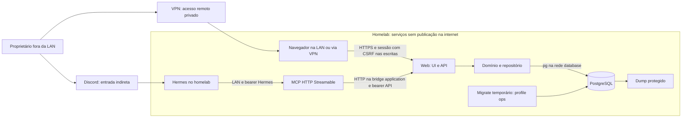

# Auditoria de segurança das comunicações — issue #7

Data: 07/11/2026. Revisão de código: `a8bf3736da9c69f997ec7f7a3b62696a55669571`, igual a `origin/main` após fetch. Worktree inicialmente limpa; entrega documental na branch `docs/7-security-audit`.

Atualização posterior à rodada original: a separação técnica de roles PostgreSQL foi implementada conforme [ADR 0012](adr/0012-database-runtime-and-migration-roles.md), com validação adicional registrada em [verification.md](verification.md). As referências de linhas e evidências da auditoria original continuam vinculadas à revisão acima; não descrevem uma nova auditoria integral do código atualizado.

## Resultado e alcance

Esta é uma auditoria **parcial, com escopo nas comunicações e perfil quick**: reconhecimento, uma rodada de investigação, revisão independente de cobertura e verificação independente do candidato. Não houve acesso a serviços do homelab, credenciais reais, Docker compartilhado ou banco persistente. Nenhuma mudança de implementação, dependência, migration ou deploy foi aplicada.

Não foi confirmada vulnerabilidade com reprodução local. Há **um candidato pendente de validação**, sobre restauração de sessões revogadas, e recomendações de contenção e operação abaixo. Isso não comprova ausência de vulnerabilidades nem segurança do deploy real.

A arquitetura exigida está preservada no código e no Compose: MCP encaminha operações à API HTTP autenticada; Web compõe domínio e persistência; MCP não recebe `DATABASE_URL`, não participa da rede `database` e não declara dependência de DB/pg/Drizzle. As evidências não autorizam atribuir isolamento financeiro por usuário: o produto tem um único proprietário, conforme [ADR 0011](adr/0011-local-user-and-database-sessions.md).

Foram revisados transporte MCP, cliente HTTP, rotas HTTP de autenticação/finanças, contratos, composição da Web, repositórios, autenticação PostgreSQL, Compose de deploy/desenvolvimento, Dockerfiles, logs e procedimentos de secrets/backup. Regras financeiras foram seguidas somente onde sustentam validação, autoria, atomicidade e idempotência. Não houve auditoria geral da UI, levantamento de CVEs, pentest do Proxmox ou inspeção da implementação externa do Hermes/Discord.

### Premissa de implantação esclarecida pelo proprietário

Web, MCP e PostgreSQL rodam no homelab, sem publicação direta na internet. O proprietário acessa a Web pela rede local e, quando está fora, entra na rede privada pela VPN. Hermes também roda no homelab e acessa MCP somente pela LAN. Discord é a única entrada externa indireta para comandos ao agente; isso não exige publicar Web ou MCP na internet.

Essa topologia é uma premissa informada pelo proprietário, incorporada nesta revisão documental. Não é resultado de inspeção do firewall, VPN ou serviços em execução. As evidências e limitações dos testes da rodada original permanecem as mesmas.

## Modelo de ameaças

Os ativos protegidos são dados financeiros, histórico e autoria de operações, credenciais, sessões, disponibilidade e backups. Estar no mesmo Proxmox não torna Hermes, VM Docker, clientes da LAN e mensagens do Discord igualmente confiáveis.

Sob essa premissa, um cliente arbitrário da internet não tem rota direta até Web/MCP. O caminho externo relevante para operações financeiras é Discord → Hermes → MCP, além do acesso remoto do proprietário após autenticar na VPN. Os cenários de abuso HTTP pressupõem acesso à LAN/VPN, comprometimento de um dispositivo interno ou uso indevido da autoridade do Hermes. Publicação acidental de porta é desvio de configuração a prevenir, não exposição observada ou premissa da auditoria.

| Principal ou entrada | Autoridade esperada | Ameaça considerada |
|---|---|---|
| Cliente da LAN/VPN sem autenticação na aplicação, ou dispositivo interno comprometido | Somente saúde e tentativa de login onde houver rota permitida | Leitura/escrita sem credencial, abuso de recursos e adivinhação de senha; sem pressupor acesso direto da internet |
| Proprietário no navegador pela LAN/VPN | Todas as finanças pessoais | Roubo de sessão, CSRF, sessão revogada/expirada ou dados privados em respostas/logs |
| Usuário/canal/mensagem do Discord | Somente o que a configuração do Hermes permitir | Outra pessoa acionar ferramentas ou receber respostas; conteúdo induzir operação não desejada |
| Hermes no homelab e quem possuir seu bearer e rota local até MCP | Consultas e escritas MCP disponíveis | Uso indevido da autoridade delegada; credencial reutilizada por outro cliente com acesso à LAN/VPN |
| MCP | API financeira com token próprio, sem SQL | Destino HTTP controlado por argumentos, perda do token e crescimento de privilégio até DB |
| Web | API/domínio e acesso ao PostgreSQL | Entradas chegando a SQL, vazamento de erros/segredos e amplitude da identidade de runtime |
| Operador, dumps e recuperação | Administração explícita e acesso restrito | Cópias de credenciais, restauração de autoridade antiga e exposição por configuração |

Comprometimento de root/Docker/hipervisor não é contido por redes Compose. O administrador desses componentes faz parte da base de confiança. Um bearer válido representa a autoridade do serviço, não a identidade de uma pessoa do Discord.

## Caminhos e fronteiras de comunicação

O navegador representa o caminho de acesso privado; o dispositivo pode estar fisicamente na LAN ou conectado por VPN. A seta Discord → Hermes representa a integração lógica, sem pressupor uma porta de entrada pública no homelab. HTTPS privado é requisito do guia, não observação da implantação; em produção, o cookie web `Secure` depende de HTTPS também na LAN/VPN. O domínio é uma camada no processo Web; não é outro serviço de rede.

| Caminho | Controle visível | Limite ou condição externa |
|---|---|---|
| Discord → Hermes no homelab | Integração fora do repositório; única entrada externa indireta de comandos ao agente | Identidade do usuário, allowlist de canais, permissões do bot, destinatário das respostas e retenção de conversas não verificados; não há premissa de endpoint MCP público |
| Hermes → MCP `/mcp` pela LAN | Bearer próprio antes de criar servidor/transporte; comparação segura; transporte stateless; corpo máximo de 64 KiB | Roteamento e ACL entre LXC/VM são locais. O guia prevê HTTPS privado; certificado e configuração real não inspecionados |
| Navegador pela LAN/VPN → Web | Sessão aleatória opaca, consulta ao DB, expiração de sete dias, usuário ativo; cookie `HttpOnly`, `SameSite=Strict`, `Secure` em produção | Acesso remoto somente após entrar na VPN. HTTPS e `APP_ORIGIN` precisam corresponder ao endereço privado real |
| Escritas web → API | Origin exato e CSRF igual na sessão, cookie e header | Origin não autentica clientes não navegador; bearer de serviço usa outra modalidade de autorização |
| MCP → Web `/api/v1/*` | Bearer diferente do Hermes, paths de ferramentas fixos, contratos de entrada/saída e timeout de 15 s | HTTP interno depende da bridge/host confiáveis; HTTPS deve ser revisto se esse salto sair dessa fronteira |
| Web → DB | `DATABASE_URL`, pg/Drizzle, consultas parametrizadas e transações | Helper não impõe TLS nem política de roles/grants; `pg_hba`, identidade e transporte efetivos não observados |
| Operação → DB | `migrate` temporário na rede DB; provisionamento administrativo explícito | Quem administra Docker/host controla secrets e banco; execução `ops` não equivale a uma ACL administrativa |

Evidências: [MCP auth](../apps/mcp/src/auth.ts), linhas 3–8; [startup MCP](../apps/mcp/src/index.ts), linhas 4–19; [servidor MCP](../apps/mcp/src/server.ts), linhas 229–265; [cliente HTTP](../apps/mcp/src/api-client.ts), linhas 18–47; [auth Web](../apps/web/src/server/auth.ts), linhas 9–46; [autorização HTTP](../apps/web/src/server/http.ts), linhas 5–13; [auth DB](../packages/db/src/auth.ts), linhas 7–72.

### Portas e redes

No [Compose de deploy](../infra/compose.yml), linhas 4–92:

- Web publica `127.0.0.1:3000` e MCP `127.0.0.1:3001` por padrão; variáveis podem mudar IP e porta. Escutar `0.0.0.0` dentro do container MCP não implica publicar todas as interfaces do host.
- `application` conecta Web/MCP. `database`, marcada `internal`, conecta Web/DB e o job de migration. PostgreSQL não publica porta no deploy.
- O [overlay de desenvolvimento](../infra/compose.dev.yml), linhas 1–12, publica PostgreSQL em `127.0.0.1:5432` por padrão e acrescenta uma bridge de desenvolvimento. O guia proíbe esse overlay em produção.
- Não há configuração de container privilegiado, rede do host ou socket Docker nos serviços examinados. Essas observações não comprovam os attachments, binds e ACLs da implantação real.

Hermes em outro LXC/host não alcança o loopback da VM pela própria interface. Deve usar o endpoint privado roteável pela LAN, com HTTPS conforme o guia e ACL restrita ao caminho necessário. Isso pode ser atendido pelo proxy privado existente, sem acrescentar exposição pública ou novo serviço. Web é acessada pela LAN/VPN; DB continua restrito à rede interna dos serviços. Não há motivo para expor DB ou entregar ao Hermes o token interno da API.

## Controles examinados e evidências

| Controle | Evidência de fonte | Resultado e limite |
|---|---|---|
| Separação de credenciais | `apps/mcp/src/index.ts:10–16`; `infra/compose.yml:27–62` | Startup MCP exige tokens diferentes, com pelo menos 32 bytes. Web valida seu bearer em tempo constante; não oferece escopos por ferramenta |
| Autorização antes do efeito | `apps/web/src/app/api/v1/[...path]/route.ts:28–36,91–102`; `apps/mcp/src/server.ts:234–244` | Auth antes de dispatch financeiro/construção do transporte. Health checks públicos retornam somente status |
| Senha e sessão | `packages/db/src/password.ts:3–16`; `packages/db/src/auth.ts:15–72` | scrypt com custos fixos e salt aleatório; tokens de 32 bytes, digest persistido; emissão serializada com reset; logout/reset revogam sessões na base ativa |
| Trabalho antes da autenticação | `packages/db/src/auth.ts:15–27`; `apps/web/src/app/api/auth/login/route.ts:6–20` | Cinco tentativas globais/15 min reservadas no DB antes de scrypt, inclusive usuário desconhecido; corpo login até 8 KiB |
| Entradas e serialização | `packages/contracts/src/index.ts:11–98`; `apps/web/src/server/http.ts:26–45` | UUIDs, enums, valores inteiros limitados ao BIGINT de entrada, parcelas 1–120 e períodos ordenados. API limita bytes acumulados a 64 KiB; não depende só de `Content-Length` |
| SQL e replay | `packages/domain/src/index.ts:97–105`; `packages/db/src/repositories.ts:54–63,239–249` | Persistência parametrizada; claim, efeito e conclusão idempotentes na mesma transação serializable. Chave ligada à operação/payload; preview não persiste e é exceção explícita |
| Autoria | `apps/mcp/src/server.ts:24–26,118–140`; rota API `:209,218`; domínio `:240–251` | Adapter força origem Hermes nas transações; correção/reversão derivam ator da autenticação, incluindo substituição. Isso não identifica o usuário Discord |
| Segredos e diagnóstico | `.gitignore`; `.dockerignore`; `apps/web/src/server/http.ts:20–23`; `apps/web/src/server/automatic-statements.ts:11–26` | Exemplos com placeholders; logs examinados usam status/contagem e erros desconhecidos genéricos. Não foi identificado sink de senha/token ou payload financeiro completo nos logs de runtime examinados |

As consultas e escritas do dono têm autoridade global por desenho; ausência de isolamento multiusuário não foi classificada como bypass. A revisão dos arquivos raiz de ignore não cobre automaticamente as políticas específicas dos Dockerfiles; essa lacuna está registrada abaixo.

## Candidato pendente de validação

### NV-01 — Recuperação pode reintroduzir sessões web revogadas

Estado: `needs_validation`, sem severidade atribuída. Fingerprint: `docs/deployment.md:restore-auth-session-resurrection`. A verificação independente confirmou o caminho condicional e manteve os bloqueios de validação.

**Cenário:** uma pessoa reteve um cookie válido; um dump foi criado antes de seu logout/reset. A sessão foi revogada na base ativa. Se esse dump for recuperado antes da expiração original e a aplicação for reaberta sem invalidar sessões restauradas, o digest antigo pode voltar a ser aceito, permitindo leituras financeiras. Expiração e usuário ativo continuam sendo verificados, mas contra o estado restaurado. O uso desse cookie também exige rota até a Web pela LAN/VPN; sua posse não cria acesso direto pela internet.

**Caminho de fonte:** `apps/web/src/app/api/auth/session/route.ts:9` lê o cookie; `docs/deployment.md:124,144` descreve dump completo e restore; `:155–157` troca a base e reabre sem exigir invalidação; `:216` inclui as tabelas de autenticação. `packages/db/src/auth.ts:35,46,51,66` mostra validade de sete dias, aceitação do digest e revogação por remoção na base ativa. `apps/web/src/server/http.ts:8–13` aceita essa sessão nas leituras financeiras.

**Controles existentes:** reset administrativo troca a senha e revoga sessões atomicamente; o guia já oferece `--reset-password` em `docs/deployment.md:206`. A ativação do restore não o exige. Um cookie expirado ou cujo usuário permaneça inativo não passa na consulta.

**Bloqueios:** não foi executado dump → revogação → restauração em PostgreSQL descartável. O procedimento efetivo do homelab pode incluir invalidação adicional que não aparece no guia. Não foi observado aceite de cookie restaurado nem acesso indevido real.

**Validação local segura:** em cluster offline descartável, criar proprietário/sessão fictícios, reter token somente na memória do teste, fazer dump, revogar e verificar retorno nulo. Restaurar em outra base descartável antes da expiração e consultar o mesmo token. Parar no estado de autenticação. Como controle, aplicar reset administrativo na base restaurada e verificar rejeição. Não usar banco real nem cookies reais.

**Observação pelo proprietário:** conferir se o runbook invalida todas as sessões restauradas e reaplica mudanças de senha posteriores ao snapshot antes de reabrir o proxy. Se não houver esse passo, a menor medida operacional proposta é incluí-lo e ensaiá-lo; nenhum reset foi realizado nesta entrega.

## Recomendações priorizadas

P1 significa verificar antes de liberar ou recuperar acesso; P2, próxima rodada de contenção; P3, manutenção. **Prioridade de trabalho não é severidade de vulnerabilidade.** Os itens de hardening não demonstram violação de fronteira por si só.

| Prioridade | Recomendação e motivo | Evidência / validação esperada |
|---|---|---|
| P1 | Conferir identidade e canais autorizados no Discord/Hermes, destinatário das respostas e tratamento de ambiguidades | Configuração externa ausente. Registrar allowlists e quem pode acionar o bot; impedir respostas financeiras em canais compartilhados. Preview e idempotência não comprovam intenção humana |
| P1 | Preservar a premissa de acesso apenas pela LAN/VPN, sem publicar Web/MCP/DB na internet | `infra/compose.yml:34,60`; `docs/deployment.md:12–23,81`. Observar binds e regras efetivas de encaminhamento/firewall; liberar o caminho local Hermes → MCP e o acesso privado à Web. A VPN é a entrada remota do proprietário. Não foi observada exposição pública |
| P1 | Resolver NV-01 antes de ativar recuperação e tratar dump como material de credenciais | Fonte e teste proposto acima; confirmar permissões, leitores, proteção fora do host e retenção dos backups, que contêm hashes de senha e estado de sessão |
| P2 | Conferir HTTPS e origem no acesso privado, conforme o guia existente | LAN/VPN reduz exposição externa, mas não muda a exigência funcional do cookie web `Secure` em produção. Conferir certificado confiável e `APP_ORIGIN` para a Web e transporte local do bearer Hermes; não exige domínio público, certificado público ou publicação na internet |
| P2 | Separar identidade PostgreSQL de runtime e administração/migration, com grants mínimos definidos | `docs/deployment.md:33` orienta usar a identidade de inicialização também na URL da aplicação; Web/migrate compartilham `DATABASE_URL`. Conferir roles/grants/`pg_hba` reais; não há prova de exploração ou de privilégio efetivo do homelab. Mudança exige decisão/ADR e testes das operações necessárias |
| P2 | Ensaiar rotação separada dos dois bearers e da credencial DB, recriando consumidores coordenadamente | Tokens capturados na inicialização e URL em pools. Revogar sessão web não revoga bearer. Registrar apenas resultado de rejeição do token antigo com fixture, nunca os valores. Rotação não foi exercitada no homelab |
| P2 | Delimitar consultas, fanout e trabalho HTTP conforme crescimento/uso do agente | `packages/domain/src/index.ts:398–418,504–518`; `packages/db/src/repositories.ts:171–188`; rota API `:67–70`: cargas amplas e `Promise.all`. Definir paginação/faixas, limites no proxy, concorrência e deadlines, com testes locais limitados; não houve demonstração de indisponibilidade |
| P2 | Preservar bridge/host como fronteira explícita para HTTP interno e pg; rever TLS se cruzarem hosts ou segmentos não confiáveis | `apps/mcp/src/api-client.ts:20,30–40`; `packages/db/src/client.ts:7–9`. Considerar rejeição de redirects e limite de resposta como defesa do cliente; não foi demonstrado SSRF nem vazamento do bearer |
| P3 | Remover do guia a geração obsoleta de `WEB_PASSWORD_HASH` e ampliar prevenção de staging de dumps/chaves | `docs/deployment.md:37–47` diverge de `:204–206`. `.dockerignore` tem padrões de dumps/chaves que `.gitignore` não replica. Sem bypass ou segredo versionado identificado nesta revisão |
| P3 | Revisar observabilidade e proveniência na próxima alteração das fronteiras | Confirmar redação/retenção em proxy/Hermes/Discord; criar regressões de bearer errado, sessão revogada/inativa e corpo chunked acima do limite. Considerar derivar `source` de toda criação na API, como já ocorre em correção/reversão |

O limite global de login permite bloqueio temporário do proprietário por consumo da janela por um cliente com rota local/VPN até a Web. Esse tradeoff já está explícito no [ADR 0011](adr/0011-local-user-and-database-sessions.md); não foi apresentado como descoberta de bypass. Limitação por origem requer configuração confiável do proxy, sem confiar cegamente em `X-Forwarded-For`.

Com a topologia esclarecida, não se pressupõe atacante anônimo da internet alcançando diretamente as rotas HTTP. As prioridades se concentram na autorização do Discord/Hermes, em manter a rede privada e em conter comprometimento interno ou perda de credenciais. Autenticação entre serviços, validação de entradas, proteção de sessões e recuperação continuam necessárias: a VPN controla entrada na rede, não autoriza cada operação financeira. Esta recalibração documental não altera o estado de NV-01 nem acrescenta achados ou testes à rodada original.

### Pendências do software independentes da rede

O [roteiro de controles nos hosts do homelab](deployment.md#controles-a-aplicar-nos-hosts-do-homelab) separa configuração externa de alterações no projeto. Sem presumir exposição à internet, os seguintes pontos continuam relevantes no software:

| Ponto | O que ainda precisa ser resolvido ou validado |
|---|---|
| Intenção nas escritas do agente | Requisito definido: toda escrita Hermes exige resumo prévio e aprovação do proprietário por reação ou resposta `aprovado`, vinculada ao payload final; mudança de campo exige nova confirmação. Fluxo documentado no deploy, ainda não implementado/validado de ponta a ponta. Schemas e idempotência não comprovam intenção humana; garantia pela API exige mecanismo adicional, não apenas instrução ao LLM |
| Recuperação de autenticação | Reproduzir NV-01 e definir invalidação das sessões restauradas antes de liberar uma recuperação. É candidato condicional, não exploração confirmada; a sessão continua sujeita a expiração e usuário ativo |
| Privilégios da conexão DB | Separação implementada no código conforme ADR 0012: `marvin_app`, `marvin_migrator` e provisionamento administrativo distinto, grants por objeto e testes positivos/negativos. Aplicação no homelab continua pendente; não há SQL injection demonstrada |
| Credenciais e artefatos | Ensaiar rotação dos bearers e credencial DB; revisar exclusões efetivas dos builds e prevenção de staging de dumps/chaves. A revisão das políticas específicas dos Dockerfiles permanece adiada. Dumps carregam também estado de autenticação |
| Disponibilidade | Limitar períodos, volume de respostas, fanout e concorrência conforme uso real. O agente pode produzir consultas custosas mesmo sendo autorizado; não foi demonstrada indisponibilidade explorável |
| Evidência de regressão | Executar os nove casos de integração PostgreSQL pulados e concluir build/E2E em ambiente adequado; acrescentar regressões focadas ao corrigir fronteiras de autorização/recuperação. Falha de build no sandbox não é, por si, vulnerabilidade |

O [fluxo de confirmação](deployment.md#confirmação-obrigatória-antes-das-escritas-do-agente) e a [separação PostgreSQL](deployment.md#separação-de-privilégios-postgresql) detalham essas duas pendências. O primeiro registra a decisão do proprietário; a segunda foi implementada no código conforme ADR 0012, sem aplicação ao banco real. A confirmação humana continua pendente de implementação; nenhuma dessas medidas foi validada no deploy real.

Autenticação, CSRF, validação runtime, SQL parametrizado e idempotência já foram examinados na rodada original; não precisam ser substituídos por uma nova stack de segurança por causa dessas pendências. A análise não incluiu revisão geral da UI nem levantamento de vulnerabilidades conhecidas nas dependências, portanto não constitui garantia sobre essas áreas. Não se afirma a existência de falha específica nelas sem investigação. Esta lista organiza o trabalho restante e não representa nova rodada de auditoria ou implementação de correções.

## Validação executada

Código foi executado somente em cópia descartável de arquivos rastreados, sem `.env` real. `bwrap --unshare-all` isolou rede/processos; somente loopback do namespace para fixtures. Ferramentas e dependências existentes foram montadas somente leitura, raiz somente leitura, ambiente iniciado vazio e escrita limitada ao tmpfs `/scratch`. Nenhum download foi permitido. Dependências locais foram reutilizadas; não se certificou uma instalação nova a partir do lockfile.

Limites: 180 s de parede, 120 s de CPU por processo, 8 GiB de espaço de endereçamento, heap Node de 512 MiB, 128 processos, 512 descritores, arquivo de até 32 MiB e tmpfs de 512 MiB. O ensaio final de build usou duas CPUs por afinidade, 256 processos, arquivo até 128 MiB e tmpfs de 768 MiB; demais limites preservados. Ambiente permitido: `PATH`, `HOME` e caches locais ao scratch, `TMPDIR`, `NODE_OPTIONS`, `NEXT_TELEMETRY_DISABLED=1`, `CI=true`, `COREPACK_ENABLE_NETWORK=0` e configurações pnpm de operação local. Nenhum segredo real foi fornecido.

| Comando/check | Resultado observado |
|---|---|
| `git fetch origin`; comparação `HEAD`/`origin/main` | Ambos em `a8bf373`; branch criada da base atualizada |
| Provas de sandbox com binários do sistema | Namespace e mounts verificados; raiz/dependências somente leitura; tentativa de escrita fora do scratch recusada. Ajustes prévios falharam antes de executar código do projeto |
| Em `apps/mcp`: `node --import tsx --test --test-isolation=none src/auth.test.ts src/api-client.test.ts src/server.test.ts` | 4 passaram, zero falhas/skips; HTTP local somente no namespace |
| Em `apps/web`: `node --import tsx --test --test-isolation=none src/server/auth.test.ts src/server/login-route.test.ts src/server/api-route-errors.test.ts` | 15 passaram, zero falhas/skips |
| `pnpm test` | 79 casos: 70 passaram, zero falhas, 9 skips. Domínio 21; MCP 4; DB 8 passaram/8 skips; Web 37 passaram/1 skip |
| `pnpm typecheck` e `pnpm lint` | Passaram em cópia offline após corrigir `/bin/sh` do sandbox |
| `pnpm build` | Contratos, domínio, DB e MCP passaram. Web não concluiu: primeiro faltaram recursos para criar worker; no ensaio final ocorreu `JavaScript heap out of memory` no ambiente limitado |
| Validadores de `findings.json` e `coverage-ledger.json` da skill | Passaram: 1 registro e 10 unidades válidas; validam estrutura, não demonstram exploração |

A primeira tentativa geral de typecheck/lint/build falhou por `/bin/sh` ausente no sandbox; a repetição foi necessária por esse motivo. Pnpm tentou conferir/sincronizar módulos e encontrou o mount somente leitura (`ERR_PNPM_PACKAGE_MANAGER_REMOVE_MODULES_DIR`); emitiu aviso e prosseguiu aos scripts, sem instalar dependências. Na repetição, typecheck/lint passaram; Web compilou, mas o build terminou por `pthread_create: Resource temporarily unavailable`, com avisos de cache `EFBIG`. O ensaio final, restrito a build e com os ajustes de recursos acima, terminou na Web com `JavaScript heap out of memory`, código 134. Não se atribuiu causa ao produto sem distinguir esses limites; **o build completo não foi aprovado** nesta auditoria.

Os nove skips correspondem às integrações que exigem PostgreSQL descartável, incluindo sessões/limites concorrentes, constraints, migrations, seed, bootstrap, snapshot e compra HTTP com persistência. Não foi executado `scripts/test-postgres.sh`: PostgreSQL não estava disponível em `/usr/bin` e o fallback usa daemon Docker compartilhado/imagem externa, fora do isolamento desta auditoria. Evidências históricas de [verification.md](verification.md) não foram contabilizadas como execução atual.

Não foram executados build Docker, renderização efetiva do Compose, E2E completo com DB, restore de NV-01 ou validação de TLS/firewall/Discord no homelab. A entrega não altera UI; não houve teste visual nesta rodada.

## Cobertura e evidências retidas

A rodada teve nove invocações independentes: quatro de reconhecimento, três de investigação, uma crítica final de cobertura e uma verificação do candidato, que reúne as duas verificações finais do perfil quick. Não foi fixado orçamento de agentes. Não havia ledger estruturado anterior compatível; o diagnóstico histórico de 31/10 foi usado como contexto, sem carregar achados como confirmações atuais.

O ledger final contém sete unidades com revisão concluída, uma com candidato `needs_validation`, uma adiada e uma fora do escopo. Revisão concluída significa somente os paths e invariantes registrados; não equivale a prova de segurança integral.

**Lacuna da crítica final:** as políticas `infra/docker/web.Dockerfile.dockerignore` e `infra/docker/mcp.Dockerfile.dockerignore` não estavam nos paths revisados pelos investigadores. Revisar apenas `.dockerignore` raiz não estabelece a política efetiva desses builds. A unidade foi registrada como adiada (`quick_profile_final_critic`), sem inferir vazamento. Uma próxima rodada deve conferir a política efetiva com marcadores fictícios, incluindo camadas, sem secrets reais. O perfil quick encerra após uma única rodada de investigação e crítica; não há alegação de cobertura exaustiva.

Evidências locais, fora do Git: `/home/gdsantana/security-audit-skill/marvin-project/run-7/`. Contém `run-metadata.json`, `architecture.md`, `coverage-ledger.json`, `findings.json`, `REPORT.md`, `FINDINGS-DETAIL.md`, `NEEDS-VALIDATION.md`, metadados dos comandos e logs mínimos em `agents/parent-checks/artifacts/`. Logs promovidos após término dos processos, com checagem de arquivo regular, link único, limites de tamanho e abertura sem seguir symlinks. Não contêm ambiente herdado ou dados reais.

## Próximo passo seguro

Validar NV-01 em PostgreSQL descartável, fechar a lacuna das políticas de build e registrar as observações do proprietário sobre Discord/Hermes, proxy/firewall, grants e rotação. Recomendações que alterem autenticação, banco ou deploy devem receber o ADR/aprovação pertinente antes de implementação. Não é necessário acrescentar SQL ao MCP nem ampliar sua rede para resolver esses pontos.
