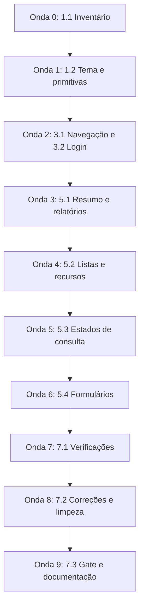

# Plano de Implementação: Refatoração visual da plataforma

## Visão Geral

Plano incremental para aplicar o design aprovado em `apps/web`. Cada fase entrega uma alteração revisável; estilos antigos coexistem durante a migração e só são removidos quando deixam de ter consumidores. Não há necessidade de sinalizador de funcionalidade, migração de dados ou alteração de implantação. Somente o tema escuro fica disponível; funcionalidades não implementadas no Figma são omitidas.

Stack: TypeScript, Next.js 15, React 19, Tailwind CSS 4, shadcn/ui, pnpm, ESLint e testes existentes com `tsx --test`. Seguir `AGENTS.md`, as fronteiras do monorepo e as orientações aplicáveis de shadcn e UX. Não adicionar uma suíte pesada de testes; reutilizar a validação de navegador e os comandos existentes, registrando dependências temporárias necessárias.

### Mapeamento Properties → tipo de verificação

| Property | Verificação | Onde está | Fase |
|---|---|---|---|
| **P1** — O tema permanece escuro nas preferências clara e escura do dispositivo; componentes consomem papéis semânticos compartilhados | Verificação estrutural dos estilos e enumeração no navegador das duas preferências | `globals.css`, `layout.tsx`, componentes migrados e roteiro em `docs/ui-validation.md` | Fases 0 e 3 |
| **P2** — Resposta antiga de consulta não aparece associada a um novo período | Enumeração no navegador com respostas atrasadas e fora de ordem | Consultas de `Workspace` e roteiro em `docs/ui-validation.md` | Fases 2 e 3 |
| **P3** — Uma repetição após falha de conexão reutiliza a chave idempotente; alterações de dados invalidam a prévia | Interceptação no navegador de requisições e verificação do estado do formulário | `Workspace`, diálogo e roteiro em `docs/ui-validation.md` | Fases 2 e 3 |
| **P4** — Rotas e diálogos mantêm acesso por teclado, nomes acessíveis e ausência de rolagem horizontal da página nas larguras obrigatórias | Enumeração no navegador de rotas, foco, dimensões e preferências de movimento | Componentes de navegação, formulários e roteiro em `docs/ui-validation.md` | Fase 3 |
| **P5** — Valores exibidos preservam moeda, precisão e classificação existentes, sem introduzir dados ilustrativos | Testes de formatação existentes e enumeração com dados sintéticos e respostas conhecidas | `finance-format.ts`, telas e roteiro em `docs/ui-validation.md` | Fases 2 e 3 |

> Tarefas marcadas com `*` são opcionais. Todas as tarefas deste plano são obrigatórias; verificações das Properties não podem ser omitidas.

---

## Tarefas

### Fase 0 — Fundação visual

- [x] 1. Preparar tema e primitivas
  - [x] 1.1 Inventariar referências, componentes e estados atuais
    - Conferir as telas e os identificadores do Figma registrados nos requisitos e preservar uma lista de elementos omitidos por ausência de implementação.
    - Registrar ações existentes, campos, condições de correção/reversão, prévias e respostas utilizadas; conferir fontes e licenças.
    - Consultar documentação shadcn e registrar pares de cores e ajustes de contraste necessários em `specs/refatoracao-visual/visual-reference.md`, como referência técnica da implementação.
    - Escrita: somente `specs/refatoracao-visual/visual-reference.md`.
    - _Requirements: 1.1, 1.3, 1.7, 4.4, 5.4, 6.3_

  - [x] 1.2 Configurar shadcn e tema semântico escuro
    - Introduzir `apps/web/components.json` e apenas as primitivas necessárias em `apps/web/src/components/ui/`; respeitar aliases existentes e compatibilidade com Tailwind 4.
    - Mapear tokens semânticos no CSS global existente, com pares de superfície/conteúdo, foco, estados e navegação; usar variantes compartilhadas e composição shadcn.
    - Aplicar `.dark` desde a renderização inicial e `color-scheme: dark`; ajustar a cor do navegador para o tema único. Não implementar paleta clara, seletor ou detecção automática.
    - Carregar Geist e JetBrains Mono conforme a disponibilidade confirmada; manter alternativas locais e legibilidade.
    - **Property 1: O tema é escuro independentemente da preferência do dispositivo e seus consumidores usam papéis semânticos.**
    - **Valida: Requisitos 1.5, 1.6, 6.2**
    - Escrita: `apps/web/components.json`, `apps/web/package.json`, `pnpm-lock.yaml`, `apps/web/src/app/globals.css`, `apps/web/src/app/layout.tsx`, `apps/web/src/components/ui/` e utilitário `cn` se necessário.
    - _Requirements: 1.1, 1.2, 1.5, 1.6, 1.7, 6.1, 6.2, 7.1, 7.4, 7.5_

- [x] 2. Checkpoint Fase 0
  - Configuração compatível com o workspace; typecheck e lint passam, ou bloqueios são registrados com causa e comando.
  - Tokens e variantes revisados; login e telas existentes permanecem utilizáveis durante a coexistência de estilos.
  - Garantir que as verificações aplicáveis passem; esclarecer decisões novas somente se forem necessárias.

---

### Fase 1 — Estrutura e autenticação

- [x] 3. Aplicar a estrutura responsiva
  - [x] 3.1 Migrar navegação e cabeçalho
    - Extrair apresentação da estrutura de `Workspace`, preservando sessão, callbacks e as seis rotas existentes.
    - Aplicar navegação lateral desktop, navegação móvel, área segura, indicação da seção atual e alvos de toque; omitir destinos e controles sem suporte.
    - Preservar acesso a todas as operações e não alterar o ciclo de vida do estado idempotente ao extrair componentes.
    - Escrita: `apps/web/src/components/workspace.tsx` e novos componentes de estrutura em `apps/web/src/components/`.
    - _Requirements: 1.2, 1.3, 2.1, 2.2, 2.3, 2.4, 2.5, 5.4, 6.1, 6.3, 7.2, 7.3, 7.6_

  - [x] 3.2 Harmonizar login e mensagens de autenticação
    - Aplicar primitivas e tema ao login; manter comportamento de entrada, sessão e redirecionamento.
    - Exibir erros compreensíveis sem conteúdo sensível, preservar nomes acessíveis e estados de envio.
    - Escrita: `apps/web/src/components/login-form.tsx` e `apps/web/src/app/login/page.tsx`.
    - _Requirements: 1.2, 1.3, 1.4, 1.5, 2.5, 6.1, 6.3, 7.1, 7.2, 7.7, 7.8_

- [x] 4. Checkpoint Fase 1
  - Login e seis destinos acessíveis em mobile e desktop; sessão e saída preservadas.
  - Typecheck e lint passam; nenhuma ação financeira é executada em banco pessoal.
  - Garantir que as verificações aplicáveis passem; esclarecer decisões novas somente se forem necessárias.

---

### Fase 2 — Telas, consultas e formulários

- [x] 5. Migrar as superfícies existentes
  - [x] 5.1 Aplicar a hierarquia visual ao resumo e aos relatórios
    - Migrar `Overview`, `SummaryTile` e `Reports` para composição semântica com dados e formatadores existentes.
    - Manter totais por moeda, período, histórico recente e faturas; não renomear saldo para patrimônio líquido.
    - Omitir gráficos, metas, análises e indicadores não implementados; não criar agregações a partir de listas incompletas.
    - **Property 5: A apresentação preserva moeda, precisão e classificação sem dados ilustrativos.**
    - **Valida: Requisitos 3.4, 3.5, 5.4**
    - Escrita: `apps/web/src/components/workspace.tsx` e componentes de resumo/relatórios extraídos nesta tarefa.
    - _Requirements: 1.1, 1.2, 1.4, 3.1, 3.2, 3.3, 3.4, 3.5, 5.1, 5.2, 5.4, 6.1, 6.3, 7.3, 7.4_

  - [x] 5.2 Migrar listas, extrato, previsões e recursos
    - Aplicar primitivas a `ResourceSection`, `Rows` e `ExpenseForecasts`; preservar informações, vínculos, revisões e condições das ações.
    - Manter somente busca e filtros já existentes e seus estados sem resultados; não adicionar controles fictícios do protótipo.
    - Garantir que valores e descrições extensas não encubram ações em telas pequenas.
    - Escrita: `apps/web/src/components/workspace.tsx` e componentes de listas extraídos nesta tarefa.
    - _Requirements: 1.2, 1.3, 1.4, 2.4, 4.1, 4.2, 4.3, 5.4, 6.1, 6.3, 7.3, 7.4, 7.6_

  - [x] 5.3 Diferenciar estados de consulta e proteger a troca de período
    - Separar apresentação de carregamento inicial, revalidação, vazio e falha; disponibilizar nova tentativa das leituras.
    - Associar resultados ao intervalo consultado e cancelar ou ignorar respostas obsoletas; não atribuir dados antigos ao período novo nem representar erro como zero.
    - Sanitizar mensagens e preservar redirecionamento de sessão existente; ajustar apresentação de acesso negado quando aplicável.
    - **Property 2: Respostas obsoletas nunca são apresentadas como resultado do período atual.**
    - **Valida: Requisitos 5.1, 5.3, 7.7**
    - Escrita: `apps/web/src/components/workspace.tsx` e componentes de estado de consulta necessários.
    - _Requirements: 3.3, 5.1, 5.3, 6.3, 7.7, 7.8_

  - [x] 5.4 Migrar formulários, prévia e revisão
    - Compor campos com `FieldGroup`, `Field`, rótulos e validação associada; usar título acessível e comportamento de foco do diálogo.
    - Preservar todas as ações e campos de `ActionDialog`, alocações, configurações de cartão, correções, reversões e previsões.
    - Preservar corpos HTTP, CSRF, descarte de prévia ao editar, chave de repetição e assinatura da tentativa; tratar falha e sucesso sem perda indevida de entrada.
    - **Property 3: Uma repetição após falha reutiliza a chave e editar o conteúdo invalida a prévia anterior.**
    - **Valida: Requisitos 4.4, 4.5, 4.6, 6.3**
    - Escrita: `apps/web/src/components/action-dialog.tsx`, extraído de `workspace.tsx` antes da migração, e tipos compartilhados em `workspace-types.ts`. Esta separação permitiu migração dos formulários em paralelo às telas, sem conflito de escrita.
    - _Requirements: 1.2, 1.4, 1.5, 4.4, 4.5, 4.6, 6.1, 6.2, 6.3, 7.1, 7.2, 7.3, 7.4, 7.5, 7.6, 7.8_

- [x] 6. Checkpoint Fase 2
  - Seis telas, login e ações existentes migrados; ausência de elementos sem suporte e revisão de diferenças em relação ao inventário inicial.
  - Typecheck, lint e testes aplicáveis passam; validar integração financeira com dados sintéticos, incluindo receita, despesa, transferência, crédito, parcelamento, pagamento parcial e idempotência.
  - Garantir que as verificações aplicáveis passem; esclarecer decisões novas somente se forem necessárias.

---

### Fase 3 — Validação e conclusão

- [x] 7. Verificar e documentar a entrega
  - [x] 7.1 Preparar e executar verificações automatizadas das Properties
    - Criar roteiro reproduzível de navegador em `scripts/validate-visual.ts`, reutilizando a infraestrutura disponível; declarar entradas e pré-requisitos sem embutir segredos ou introduzir framework pesado.
    - Usar dados sintéticos e interceptação de requisições para enumerar preferências clara/escura, respostas fora de ordem, falha com reenvio, descarte de prévia e moeda/valores conhecidos.
    - Enumerar as seis rotas, login e diálogos em 390 × 844 e 1440 × 900; verificar rolagem horizontal, nomes dos controles, foco, Escape e movimento reduzido.
    - **Property 1: Tema escuro e papéis semânticos verificados.**
    - **Property 2: Troca de período resistente a respostas fora de ordem.**
    - **Property 3: Reenvio e prévia preservam garantias existentes.**
    - **Property 4: Rotas e diálogos preservam acesso e dimensões obrigatórias.**
    - **Property 5: Valores e capacidades correspondem aos dados reais.**
    - **Valida: Requisitos 1.5, 1.6, 2.1, 2.4, 3.4, 3.5, 4.4, 4.5, 4.6, 5.1, 5.4, 6.3, 7.2, 7.3, 7.5, 7.6**
    - Escrita: `scripts/validate-visual.ts` e `docs/ui-validation.md`; somente dados sintéticos e evidências sem informações pessoais.
    - _Requirements: 1.5, 1.6, 2.1, 2.4, 2.5, 3.3, 3.4, 3.5, 4.4, 4.5, 4.6, 5.1, 5.3, 5.4, 6.3, 7.2, 7.3, 7.5, 7.6, 7.7, 7.8_

  - [x] 7.2 Corrigir achados visuais e remover estilos sem consumidores
    - Inspecionar capturas mobile/desktop, contraste dos pares finais, teclado e leitura assistiva; comparar hierarquia visual com o Figma e justificar adequações acessíveis.
    - Corrigir problemas nas superfícies migradas; remover somente estilos e trechos tornados obsoletos por esta refatoração.
    - Registrar evidências e limitações; uma verificação automatizada parcial não autoriza afirmar conformidade integral WCAG.
    - Escrita: arquivos visuais já migrados, `specs/refatoracao-visual/visual-reference.md` e `docs/ui-validation.md`.
    - _Requirements: 1.1, 1.2, 1.3, 1.7, 2.2, 2.3, 2.4, 6.1, 6.2, 7.1, 7.2, 7.3, 7.4, 7.5, 7.6_

  - [x] 7.3 Executar o gate final e atualizar documentação
    - Executar typecheck, lint, testes aplicáveis e build de `@finance/web`; repetir os cenários de navegador afetados pelas correções de 7.2.
    - Atualizar `ARCHITECTURE.md` §6, README, `docs/ui-validation.md` e registrar a decisão durável de tema/componentes em ADR com o próximo número livre.
    - Informar comandos, resultados, limitações, componentes adotados e elementos do Figma omitidos. Não documentar como concluídas verificações que não puderam ser executadas.
    - Escrita: documentação citada e novo ADR; eventuais falhas exigem voltar à tarefa responsável antes de marcar conclusão.
    - _Requirements: 1.1, 1.3, 1.5, 1.6, 1.7, 5.4, 6.2, 6.3, 7.1, 7.6, 7.8_

- [x] 8. Checkpoint Fase 3
  - Properties P1–P5 executadas, comandos do gate aprovados e evidências de interface revisadas; limitações materiais impedem declarar entrega integral até resolução.
  - Nenhuma alteração em contratos, regras financeiras, banco, MCP ou implantação; funcionalidades existentes e alterações prévias preservadas.
  - Garantir que as verificações aplicáveis passem; esclarecer decisões novas somente se forem necessárias.

---

## Notas

- São 11 subtarefas obrigatórias, quatro agrupadores e quatro checkpoints. Não há subtarefas opcionais.
- Não há proposta de testes baseados em propriedades aleatórias: as Properties usam verificações estruturais, testes existentes e enumeração de cenários no navegador.
- Busca, filtros e gráficos condicionais dos requisitos não autorizam funcionalidades novas; registrar casos não aplicáveis com justificativa no inventário.
- O roteiro automatizado complementa a inspeção visual, a leitura assistiva e a medição de contraste; não substitui essas verificações.
- A execução respeita os limites de escrita de cada tarefa e preserva alterações existentes. A pessoa mantenedora autorizou explicitamente em 2026-10-26 a execução de todas as ondas até o final, com multiagentes em paralelo nos escopos independentes; não são necessárias aprovações intermediárias.

---

## Grafo de Dependências de Tarefas

```json
{
  "waves": [
    { "id": 0, "tasks": ["1.1"] },
    { "id": 1, "tasks": ["1.2"] },
    { "id": 2, "tasks": ["3.1", "3.2"] },
    { "id": 3, "tasks": ["5.1"] },
    { "id": 4, "tasks": ["5.2"] },
    { "id": 5, "tasks": ["5.3"] },
    { "id": 6, "tasks": ["5.4"] },
    { "id": 7, "tasks": ["7.1"] },
    { "id": 8, "tasks": ["7.2"] },
    { "id": 9, "tasks": ["7.3"] }
  ]
}
```

### Visualização (mermaid)



> **Notas sobre o grafo**
>
> - Cada onda contém apenas tarefas independentes entre si; tarefas posteriores dependem de todas as anteriores.
> - As tarefas 3.1 e 3.2 escrevem em conjuntos distintos de arquivos; mudanças em primitivas compartilhadas devem ser encaminhadas para uma tarefa sequencial antes de prosseguir.
> - As tarefas que alteram `workspace.tsx` estão em ondas diferentes.
> - Apenas subtarefas decimais aparecem no grafo; agrupadores e checkpoints estão excluídos.

## Registro de execução

Todas as tarefas e checkpoints foram executados. A separação prévia de `action-dialog.tsx` e `workspace-types.ts` permitiu trabalho paralelo nos formulários e nas telas; login, inventário, validação e documentação tiveram responsabilidades disjuntas. A pessoa mantenedora autorizou o avanço até a conclusão sem aprovações intermediárias.

Gate final: typecheck e lint de todos os workspaces, 35 testes com zero skips em PostgreSQL descartável, build web, integração de produção web/MCP e 60 cenários de navegador aprovados. Os últimos ajustes visuais foram recompilados e validados em cópia temporária com fontes e configurações web comparadas ao checkout, evitando concorrência com o servidor de desenvolvimento existente. Revisão final sem regressões materiais adicionais.

As medições de contraste, capturas, comandos, falsos positivos corrigidos no roteiro e limites de validação estão em `docs/ui-validation.md` e `visual-reference.md`. Não houve teste em dispositivo físico ou operação manual com leitor de tela; a validação automatizada não é uma certificação integral WCAG.
